# 三种全球人工智能天气预报模型的台风路径评估——基于2025年西北太平洋样本

## 摘要

热带气旋路径决定了灾害可能影响的区域，是检验全球人工智能天气预报模型高影响天气预测能力的重要对象。本文使用同源ERA5初始化资料和JMA最佳路径资料，在配对起报时刻及一致中心追踪规则下，比较GraphCast、Pangu-Weather和FourCastNet在6–120 h的路径预报表现。主分析包括14个具有完整120 h验证记录的台风、74个起报案例；另外13个台风的截短案例用于补充分析。评价依次考察总体误差及模型差异、沿轨与横轨误差、转向前后阶段及路径分组、模型分歧与共识路径误差的关系，并以台风为重采样单位估计统计不确定性。

主分析中，GraphCast在6–66 h的平均直接路径误差最小，Pangu-Weather在72–120 h最小。120 h时，三模型的平均直接路径误差分别为483.7、341.0和705.0 km，距离均方根误差分别为576.4、445.2和859.3 km。GraphCast与Pangu-Weather的样本平均排序随时效改变，但覆盖三组模型配对和20个时效的同时置信带尚未支持两者发生明确的优势转换。三模型在120 h的平均绝对沿轨误差均大于横轨误差。按JMA路径识别的5个转向台风，在同台风、同预报时效的可匹配阶段中，三模型转向后平均DPE均较高，但个例方向不一致，9项同时置信区间均包含零；整段路径分组的120 h差异也缺乏联合统计支持。另13个截短台风在共同6–36 h均呈现GraphCast样本平均DPE最小，却显示不同的模型误差增长，且无法检验转向前后配对与120 h。模型分歧与共识路径误差在24和48 h呈正相关，72–120 h的关联证据较弱；120 h留出台风检验的命中率为28.6%，虚警比例为68.5%。结果说明，总体误差排名需要结合误差方向、路径类型和统计不确定性解释，三模型的位置分歧也不能直接视为经过校准的预报风险概率。

**关键词：** 人工智能天气预报；台风路径；沿轨误差；转向；模型分歧；台风重采样

## 目录

- [第一章 绪论](#chapter1)
- [第二章 数据及方法](#chapter2)
- [第三章 平均误差的比较](#chapter3)
- [第四章 台风路径变化的评估](#chapter4)
- [第五章 模型分歧与台风预报误差的关系](#chapter5)
- [第六章 总结与展望](#chapter6)
- [附录A 结果的可靠性](#appendix-a)
- [附录B 中心追踪细节](#appendix-b)
- [附录C 统计计算与程序](#appendix-c)
- [参考文献](#references)
- [致谢](#acknowledgements)

<a id="chapter1"></a>

## 第一章 绪论

### 1.1 背景及意义

近年来，全球人工智能天气预报模型快速发展，形成了多种数据驱动的预报路线。本文选取GraphCast、Pangu-Weather和FourCastNet作为比较对象，涵盖图神经网络、三维Transformer和自适应傅里叶神经算子三类模型设计。[[3]](#ref-3)[[4]](#ref-4)[[7]](#ref-7)

热带气旋伴随强风、暴雨、洪水和风暴潮，能够造成严重人员伤亡与财产损失。台风路径关系到受影响区域和登陆位置的判断，准确的路径预报是开展风险预警和防灾部署的重要依据。[[1]](#ref-1)

台风路径也是检验天气预报模型预测能力的一项重要任务。模型给出的是连续大气场，需从中识别并追踪气旋中心，再与最佳路径资料比较，才能评估模型对台风位置和移动的预测表现。[[2]](#ref-2) 本文在一致的验证条件下比较三种模型，为认识全球人工智能天气预报模型的台风路径能力及误差特征提供同样本的实证依据。

### 1.2 人工智能天气预报模型与台风路径研究进展

#### 1.2.1 全球人工智能天气预报模型的发展

全球人工智能天气预报研究先建立统一数据和评价标准，再逐步发展到高分辨率确定性预报与概率预报。WeatherBench以ERA5资料构建全球中期预报基准，使不同数据驱动方法能够在共同变量、时效和指标下比较；WeatherBench 2进一步将评价范围扩展到1—14天，并把数据驱动模型与业务物理模式纳入同一评价框架。[[15]](#ref-15)[[16]](#ref-16) 统一基准推动研究重点由“能否预测全球气象场”转向“在相同条件下能否达到稳定、可复核的预报水平”。

国内研究中，Bi等提出的Pangu-Weather采用三维地球特定Transformer，将同一时刻的高空气象场与地面气象场共同作为输入。模型首先把气象场划分为小块并编码，按照气压层、经度和纬度组织为三维特征。随后，通过注意力机制学习不同位置和高度之间的联系，并通过移动窗口划分，使相邻窗口交换信息。模型还引入与气压层和纬度位置有关的可学习位置偏置，将地球空间位置的差异纳入计算。最后，解码器把处理后的特征还原为未来时刻的气象场。[[4]](#ref-4)

在时间推进方面，Pangu-Weather分别训练了预报步长为1、3、6和24 h的网络，并采用分层时间聚合策略组合使用。例如，预报未来30 h的大气状态时，可先推进24 h，再推进6 h。这样可以减少达到目标时效所需的迭代次数，减轻逐步预报中的误差累积。[[4]](#ref-4) Chen等提出的FuXi则采用级联模型，由不同模型分别承担不同预报阶段，开展了15天全球天气预报研究。[[8]](#ref-8)

随着确定性模型能力提高，人工智能天气预报开始进一步描述预报不确定性。Price等提出的GenCast采用条件扩散模型生成多条可能的大气演变轨迹，形成15天全球集合预报，并专门评价热带气旋路径等高影响天气。[[17]](#ref-17) 这一进展使人工智能天气预报由输出单一路径，拓展到同时给出多种可能情景及其分布。

国际研究中，Lam等提出的GraphCast采用图神经网络学习全球大气状态的变化。模型输入当前时刻及其前6 h的气象场，输出未来6 h的气象场。其计算过程包括编码、信息传递和解码三个环节：首先将经纬度网格上的气象信息映射到球面网格的节点；随后沿节点之间的连接传递并更新特征；最后将更新后的特征映射回经纬度网格，得到各气象变量的预测结果。其中，多尺度球面网格同时设置短距离和长距离连接，使模型能够结合局地信息与较远区域的信息。将预测结果继续作为输入，即可逐次生成更长时效的预报。[[3]](#ref-3)

Pathak等提出的FourCastNet采用自适应傅里叶神经算子（AFNO）处理全球气象场。模型先将多变量气象场划分为小块，并把每个小块编码为特征；随后对这些特征进行二维傅里叶变换，将空间变化表示为不同空间频率的成分。网络在频域中学习特征变换，再通过逆傅里叶变换返回空间域，实现不同区域之间的信息交互。经过多层处理后，解码器重建未来时刻的气象场。该设计利用傅里叶变换处理大范围空间联系，并以6 h为步长，将前一步预测结果用于后续预报。[[7]](#ref-7)

GraphCast、Pangu-Weather和FourCastNet分别通过球面图上的信息传递、三维注意力计算和傅里叶域中的特征变换组织气象信息，形成了三条具有不同空间信息处理方式的全球预报路线。三者均输出可用于气旋追踪的气象场，为在同一批台风样本上比较路径预报表现提供了条件。本文据此选取这三个模型，在一致的追踪和验证规则下，研究其路径误差及随预报时效和路径形态的变化。

#### 1.2.2 热带气旋专项验证的进展

人工智能天气预报模型的热带气旋研究已由单个模型的能力评估，发展到多个模型在共同验证条件下的比较。DeMaria等使用GFS分析场初始化，采用美国国家飓风中心的验证流程，评估GraphCast-operational、Pangu-Weather、FourCastNetv1和FourCastNetv2-small对2023年5—11月北半球热带气旋的路径与强度预报。研究发现，这些模型的路径误差和气旋检出率与表现较好的业务模型相当，将其预报加入多模型共识后，还能改善部分长时效的路径预测。该研究把单模型评价与多模型组合联系起来，展示了人工智能预报在热带气旋路径业务中的应用价值。[[5]](#ref-5)

面向热带气旋的专门模型进一步把研究对象扩展到路径、强度和风圈大小的联合预测。Alet等于2026年发表的WeatherNext Cyclones研究，将全球大气分析资料与历史热带气旋记录结合训练，生成未来15天的多种可能情景，并在2023—2025年热带气旋样本上开展验证。该研究同时评价平均预测结果与概率预报质量，体现了热带气旋研究从预测位置向描述未来演变及其不确定性的拓展。[[9]](#ref-9)

热带气旋路径检验还形成了直接路径误差、沿轨误差和横轨误差等常用指标。Leonardo和Colle在北大西洋多模式集合预报中，将总位置误差分解为沿实际路径方向和垂直于路径方向的分量，并发现多种模式在120 h表现出明显的沿轨慢偏差。[[20]](#ref-20) 这种分解把“预测位置偏离多远”进一步落实为“移动速度方向的前后错位”和“路径左右偏离”，为分析不同路径形态下的误差来源提供了方法基础。

#### 1.2.3 多模型分歧与误差风险

多模型共识通过综合不同模型的预测位置降低单一模型误差。Goerss对多个动力模式的热带气旋路径进行组合，发现72 h共识路径误差比表现最好的单一模型低16%—23%，说明不同模型的偏差可以在组合中相互抵消。[[18]](#ref-18) 后续研究进一步把模型分散程度用于预测共识误差。Goerss以共识成员的路径离散度、气旋强度等预报发布时即可获得的量为输入，建立了分时效的共识误差预测模型，表明模型分歧可以参与预报置信度判断。[[19]](#ref-19)

模型分歧与实际误差并非一一对应。Elsberry和Carr基于西北太平洋381个案例分析五个动力模型，发现模型预测较集中时，共识误差通常较小，但也存在多个模型共同偏离真实位置的案例；模型预测较分散时，不同方向的偏差也可能经平均后得到较准确的共识路径。[[10]](#ref-10) 因此，分歧既要用于衡量案例间的风险排序，也要通过命中率、虚警比例等指标检验它能否筛选实际的大误差案例。本文第五章据此评价三个AI模型的位置分歧，并讨论它在台风路径预报核查中的用途。


### 1.3 本文的研究内容

本文以2025年西北太平洋台风为研究对象。图1-1展示该年度27个台风的路径分布，提供研究区域与路径形态的空间背景；主分析及补充样本的划分见第2.1.1节。[[14]](#ref-14)

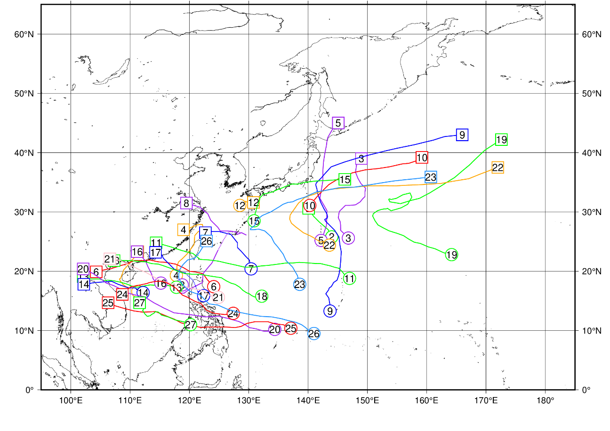

**图1-1 2025年西北太平洋台风路径。** 图中数字为当年台风序号，圆圈和方框分别标记台风生成与消散位置，虚线表示热带低压阶段。来源：日本气象厅《2025年台风总结（确定版）》（2026年3月27日），图3；[[14]](#ref-14)

本文按照“总体误差—路径变化—风险提示”的顺序展开。首先建立可比较的样本，回答三个模型平均偏离多远、差异如何随时效变化；随后把位置误差分解到实际运动方向的前后及左右，按最佳路径识别转向时刻，在同一台风、相同预报时效上比较转向前后阶段，再比较两类台风及模型差异；最后检验三个模型的位置分歧能否在实际误差未知时提供风险信息。可靠性检验贯穿上述分析，在附录集中报告。

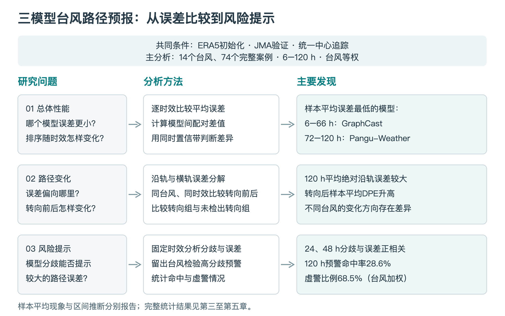

**图1-2 研究问题、分析方法与主要发现。** 三行依次对应总体性能、路径变化和风险提示；每行从左到右连接研究问题、分析方法和主分析样本中的主要发现。

第二章先介绍最佳路径资料和台风样本，再介绍初始化资料与模型配置，说明中心追踪、误差计算及统计比较方法，建立三模型共同的评价标准。

第三章比较三模型在6–120 h的总体路径预报表现。通过平均直接路径误差和距离均方根误差评价预报准确程度，再利用相同案例下的模型配对差值及其置信区间，分析模型间的差距和相对排序随预报时效的变化。

第四章分析路径变化与预报误差的关系。首先考察6–120 h的沿轨和横轨误差，说明预测位置相对实际运动方向的超前、滞后及左右偏离。随后根据JMA最佳路径识别转向时刻，在同一台风、相同预报时效下比较转向前后的误差大小与方向。最后比较转向组与未转向组，并考察三模型在各组中的表现，回答转向前后误差如何变化、不同路径类型下模型表现有何差异。

第五章检验模型分歧能否提示大误差风险。先分析三个预测中心的分散程度与共识路径误差的关系，再用未参与确定阈值的台风检验高分歧预警的识别效果，评价其命中与虚警情况。

第六章总结三模型的总体性能、路径变化中的误差特征和模型分歧的风险提示价值，并提出后续研究方向。附录通过13个补充台风、逐一删除台风及改变追踪参数等检验，评估主要结论在不同样本和分析设置下的稳定性。

<a id="chapter2"></a>

## 第二章 数据及方法

### 2.1 数据收集与处理

#### 2.1.1 最佳路径与起报案例

本文选择2025年西北太平洋台风，兼顾资料的新近性、年度完整性及验证年份与公开训练时段的关系。截至本研究资料整理时（2026年10月），2025年是最近一个已经结束的完整公历年，JMA提供该年度的最佳路径资料。[[6]](#ref-6) 根据模型公开说明，GraphCast_operational在1979–2017年ERA5资料上预训练，并以2016–2021年HRES资料微调；Pangu-Weather和FourCastNet原研究的训练资料分别覆盖1979–2017年和1979–2015年。[[3]](#ref-3)[[4]](#ref-4)[[7]](#ref-7) 据此，本文将2025年设为上述公开训练时段之后的验证年份，评估三模型对近期台风过程的路径预报表现。

本文采用JMA RSMC Tokyo最佳路径作为位置验证资料，研究对象为2025年编号2501–2527的27个热带气旋，下文统称为“台风”。[[6]](#ref-6) 对每个台风，以其首次达到热带风暴及以上等级的时刻作为安排起报的起点，按JMA等级代码3–5识别。一个起报案例定义为“一个台风在一个起报时刻的预报”。

三模型统一在每日06和18 UTC起报。对同一个台风，首次起报安排在其首次达到热带风暴及以上等级之后（含该时刻）的第一个06或18 UTC。此后每隔12 h，使用对应时刻的初始化资料重新开展一次预报，形成一个新的起报案例（case）。因此，12 h是同一台风相邻两次起报的时间间隔，三模型在每个case中使用相同的起报时刻。

在每个case内，预报结果按6 h间隔输出和验证，即分别比较起报后6、12、18 h等时效的预测中心与JMA中心位置。完整120 h案例共包含20个评分时效。这里的6 h是同一次预报中相邻输出时效的间隔，12 h则是两次重新起报之间的间隔。

样本按可连续验证的时长划分。主分析保留起报后0–120 h每隔6 h均有JMA位置记录、且等级代码均为2–5的案例；这些等级依次对应热带低压、热带风暴、强热带风暴和台风，覆盖达到热带风暴等级后的发展及减弱阶段。筛选得到14个台风、74个完整案例；另外13个台风各保留一个可验证时长为36–108 h的截短案例，用于补充分析。全部87个案例对应71个唯一起报时刻，同一时刻的全球预报可用于验证多个台风。

**表2-1 样本设置。**

| 分析范围 | 台风数 | 起报案例数 | 验证窗口 | 用途 |
|---|---:|---:|---|---|
| 主分析 | 14 | 74 | 均有完整0–120 h记录 | 固定样本下的逐时效比较 |
| 其他台风 | 13 | 13 | 每例36–108 h | 补充检查短时效及样本构成影响 |
| 全部可用案例 | 27 | 87 | 按时效纳入有效记录 | 附录A，不替代主分析 |

完整窗口筛选使主分析的时效变化不受台风数量减少的直接影响，也将其适用范围限定为满足该条件的台风及起报阶段。截短表示保留的可验证窗口不足120 h，不表示模型无法运行到120 h。全部样本分析在各时效另行报告有效台风数和案例数。

#### 2.1.2 初始化资料与模型配置

三种模型均从给定时刻的大气状态出发，预测后续气象场。因此，开展2025年台风回报试验，需要收集各起报时刻的全球气象资料，为模型提供预报的起点。本文采用ERA5再分析资料，其通过资料同化将观测与数值模式结合，提供覆盖全球、逐小时的大气状态估计，并包含多个气压层及近地面的气象变量。全球覆盖和连续的时间记录便于组织三模型所需的输入，也能提供GraphCast所需的起报前6 h资料。[[12]](#ref-12)

本文在相同起报时刻，从ERA5中提取各模型所需的变量和气压层，构建初始化输入。采用同一资料来源和配对起报时刻，可减少资料来源及起报时间不同对模型比较的影响。各模型随后生成未来气象场，从中提取台风中心位置，并与JMA最佳路径对照，计算路径误差。ERA5用于初始化，JMA最佳路径用于位置验证，二者分别承担提供预报起点和评价预报结果的作用。

三模型的输入与输出按表2-2统一列示。表中的气象变量指模型实际使用的变量；预报场用于提取中心位置，路径误差由预测中心与JMA中心之间的距离计算。

**表2-2 三模型的初始化输入与预报输出。**

| 对照项目 | GraphCast | Pangu-Weather | FourCastNet |
|---|---|---|---|
| 本文采用的模型 | GraphCast_operational | 6 h与24 h预报模型 | 基于自适应傅里叶神经算子的FourCastNet |
| 初始化资料 | ERA5全球再分析场 | ERA5全球再分析场 | ERA5全球再分析场 |
| 输入时刻 | 起报时刻及其前6 h | 起报时刻 | 起报时刻 |
| 高空气象变量 | 温度、位势、纬向风、经向风、垂直速度、比湿 | 温度、位势、纬向风、经向风、比湿 | 温度、位势、纬向风、经向风、相对湿度；各变量层次见注② |
| 高空气压层 | 13层，50–1000 hPa，见注① | 同左，共13层 | 涉及50、500、850、1000 hPa，按变量选取 |
| 地面及整层变量 | 2 m气温、海平面气压、10 m纬向风和经向风 | 同左，共4项 | 左列4项，加地面气压、整层水汽含量 |
| 水平网格间距 | 0.25° × 0.25° | 0.25° × 0.25° | 0.25° × 0.25° |
| 预报推进方式 | 每次推进6 h，将预测状态用于后续预报 | 24 h模型推进整日时效，6 h模型生成中间时效 | 每次推进6 h，将预测状态用于后续预报 |
| 输出气象场 | 上述高空、地面变量及6 h降水量 | 上述高空及地面变量 | 上述高空、地面及整层变量，另由降水模块生成降水场 |
| 路径追踪使用的输出 | 海平面气压、10 m纬向风和经向风 | 同左 | 同左 |
| 本文验证时效 | 6–120 h，间隔6 h | 同左 | 同左 |

注：①13个气压层为50、100、150、200、250、300、400、500、600、700、850、925和1000 hPa。②FourCastNet使用温度（500、850 hPa）、位势（50、500、850、1000 hPa）、纬向风和经向风（500、850、1000 hPa）、相对湿度（500、850 hPa），共14项高空变量，与6项地面及整层变量合计20项。③GraphCast还使用地表位势、海陆掩膜以及时间和太阳辐射信息。其运行接口准备了零值降水字段，所用权重的实际输入变量清单不含降水，降水为预测输出。模型文件与运行参数见附录C。

Pangu-Weather采用两种步长，以减少长时效预测的连续迭代次数，同时保留每6 h的结果。例如，24 h结果由24 h模型生成，30 h结果在此基础上通过6 h模型得到。[[4]](#ref-4)

#### 2.1.3 中心提取与连续追踪

三模型预报场采用相同追踪规则。起报时刻以JMA中心为共同锚点，6 h时效围绕该位置搜索；从12 h起，根据前两次识别位置的位移外推0.75倍，确定新的搜索锚点。6 h的搜索半径为700 km，随后每6 h增加20 km，上限1000 km。

程序先从搜索区域中选出低压候选点，再根据候选点与搜索锚点的距离、气压亏缺和近中心风速计算综合得分。候选点 $c$ 在第 $k$ 个预报时次的得分为

$$
S_k(c)=\frac{d(c,a_k)}{r_k}
-\frac{\delta p_k(c)}{20\ \mathrm{hPa}}
-0.35\frac{V_{250}(c)}{40\ \mathrm{m\,s^{-1}}},
\qquad
\delta p_k(c)=\max\{0,p_{\mathrm{med},k}-p(c)\}.
$$

其中，$a_k$ 为当前搜索锚点，$d(c,a_k)$ 为候选点到锚点的大圆距离，$r_k$ 为当前搜索半径，二者均以km计；$p(c)$ 为候选点的海平面气压，$p_{\mathrm{med},k}$ 为当前搜索区域内有效海平面气压的中位数，二者均以hPa计。气压亏缺 $\delta p_k(c)$ 表示候选点气压低于该中位数的幅度，气压高于中位数时取零。$V_{250}(c)$ 为候选点周围250 km范围内的最大10 m风速，单位为 $\mathrm{m\,s^{-1}}$。

评分中，距离、气压亏缺和风速三项的权重分别为1、1和0.35；距离以当前搜索半径归一化，气压亏缺和风速分别以20 hPa和40 $\mathrm{m\,s^{-1}}$ 归一化，使三项均为无量纲数。这两个固定尺度用于调整各项在总分中的贡献。距离项取正号，气压亏缺项和风速项取负号，因此在其他条件相同时，候选点越靠近锚点、气压亏缺越大或近中心风速越大，得分就越低。程序选择得分最低的候选点作为该时次的预报中心。

三模型使用同一套评分参数。缺少有效风速时省略风速项；本试验的涡度项权重为零。候选点筛选及同分处理顺序见附录B，追踪参数敏感性检验见附录A。起报后的JMA中心用于路径验证，后续搜索锚点由此前识别的预报中心更新。

本文使用已保存的区域预报场，裁剪范围根据事后获得的最佳路径确定，用于历史台风的回报试验。三模型采用相同的中心追踪规则，参数敏感性分析结果见附录A。

### 2.2 评估方法与指标

#### 2.2.1 直接路径误差、平均值与均方根误差

直接路径误差（direct position error，DPE）为预报中心与同一有效时刻JMA中心之间的大圆距离。分别以 $(\phi_f,\lambda_f)$ 和 $(\phi_o,\lambda_o)$ 表示预报中心、JMA中心的纬度与经度，角度均换算为弧度，则

$$
a=\sin^2\frac{\phi_f-\phi_o}{2}
 +\cos\phi_f\cos\phi_o\sin^2\frac{\lambda_f-\lambda_o}{2},
\qquad
E=2R\arcsin\sqrt a,
$$

其中 $R=6371.0088\ \mathrm{km}$，$E$ 为DPE。数值计算将 $a$ 限制在 $[0,1]$，以避免浮点舍入造成定义域错误。起报时刻直接使用JMA位置，故0 h不计入模型性能评分。

本文采用台风等权。设 $E_{ijm}(\tau)$ 为台风 $i$ 的第 $j$ 个案例、模型 $m$、时效 $\tau$ 的DPE，$n_i$ 为该台风的案例数，$N$ 为台风数，则平均DPE为

$$
\overline E_m(\tau)=\frac1N\sum_{i=1}^{N}
\left[\frac1{n_i}\sum_{j=1}^{n_i}E_{ijm}(\tau)\right].
$$

距离均方根误差定义为

$$
\operatorname{RMSE}_m(\tau)=
\sqrt{\frac1N\sum_{i=1}^{N}
\left[\frac1{n_i}\sum_{j=1}^{n_i}E_{ijm}^{2}(\tau)\right]}.
$$

两个指标均以km为单位，且每个台风具有相同总权重。平均DPE描述平均偏离距离；RMSE在平均前先平方，对大偏差更敏感。这里的RMSE是距离误差的均方根，不是经纬度坐标误差的混合，也不是先计算各台风RMSE再求平均。平方、开方与求平均的顺序不同，得到的统计量也不同。

#### 2.2.2 台风重采样与模型配对比较

同一台风的多个起报案例共享部分天气过程，因此本文以台风为重采样单位，将每个台风的全部案例作为一个整体保留，并以不同台风作为近似独立的抽样单位。不同台风的预测难度和误差水平有所差异，样本中各台风的构成会影响总体均值。bootstrap通过反复改变各台风在重采样中的出现次数，估计总体指标随样本构成变化的波动范围，为均值和模型差异提供置信区间。[[11]](#ref-11)

对于平均DPE和RMSE，每次从主分析的14个台风中有放回地抽取14次。同一台风可以重复出现，未被抽中的台风在该次计算中不参与平均；每次均按第2.2.1节的台风等权规则重新计算指标。重复10000次后，取重采样结果的第2.5和97.5百分位数，得到各模型、各时效的95%置信区间。

模型间比较首先固定台风、起报时刻和预报时效，计算同一案例下两模型的DPE差值。这样，每一项差值都对应同一次台风过程的同一验证时刻。对模型A和B，定义

$$
\Delta_{ij}^{A-B}(\tau)
=E_{ijA}(\tau)-E_{ijB}(\tau).
$$

随后，先对台风 $i$ 的 $n_i$ 个案例取平均，再对 $N$ 个台风等权平均：

$$
D_i^{A-B}(\tau)
=\frac{1}{n_i}\sum_{j=1}^{n_i}\Delta_{ij}^{A-B}(\tau),
\qquad
\widehat{\Delta}^{A-B}(\tau)
=\frac{1}{N}\sum_{i=1}^{N}D_i^{A-B}(\tau).
$$

其中，$E_{ijA}(\tau)$ 和 $E_{ijB}(\tau)$ 为第2.2.1节定义的大圆距离误差，$D_i^{A-B}(\tau)$ 为台风内平均差值，$\widehat{\Delta}^{A-B}(\tau)$ 为台风等权平均差值，单位均为km。差值为负表示A的平均DPE较小，为正表示B的平均DPE较小。本文分别比较GraphCast−Pangu-Weather、GraphCast−FourCastNet和Pangu-Weather−FourCastNet。

三组模型配对分别在6、12、…、120 h进行比较，共形成 $3\times20=60$ 项差值。如果逐项查看95%区间，随着比较项增多，至少一项因样本波动而呈现差异的机会也会增加。因此，本文同时报告逐项置信区间与覆盖全部60项比较的近似95%同时置信带，用统一的整体标准判断模型差异。

为保留同一台风在不同模型配对、不同预报时效之间的联系，每次重采样均对全部60项比较使用同一组台风索引。例如，某个台风被抽中两次，它在三组配对、20个时效中的差值都随之出现两次。令 $k=1,\ldots,60$ 表示一个“模型配对—预报时效”组合，$D_{ik}$ 表示台风 $i$ 在该组合下的平均差值。第 $b$ 次重采样抽到的台风索引为 $I_1^{(b)},\ldots,I_N^{(b)}$，则

$$
\widehat{\Delta}_k=\frac{1}{N}\sum_{i=1}^{N}D_{ik},
\qquad
\widehat{\Delta}_k^{*(b)}
=\frac{1}{N}\sum_{\ell=1}^{N}D_{I_\ell^{(b)},k}.
$$

联合重采样重复 $B=100000$ 次。对每个 $k$，取 $\widehat{\Delta}_k^{*(1)},\ldots,\widehat{\Delta}_k^{*(B)}$ 的第2.5和97.5百分位数，得到该配对、该时效的逐项95%置信区间。

同时置信带进一步考虑60项差值共同波动的幅度。先在原样本中，对每个 $k$ 计算台风平均差值的标准差 $s_k$ 及总体平均差值的标准误 $\widehat{\mathrm{SE}}_k$：

$$
s_k^2=\frac{1}{N-1}\sum_{i=1}^{N}
\left(D_{ik}-\widehat{\Delta}_k\right)^2,
\qquad
\widehat{\mathrm{SE}}_k=\frac{s_k}{\sqrt{N}},
\qquad N=14.
$$

这里，$s_k$ 描述不同台风之间的差值波动，$\widehat{\mathrm{SE}}_k$ 则衡量这些台风等权平均后所得差值的抽样不确定性。在第 $b$ 次重采样中，计算各项重采样均值偏离原样本均值的程度，并除以各自的原样本标准误。取60项绝对标准化偏差中的最大值：

$$
M^{*(b)}
=\max_{k=1,\ldots,60}
\left|
\frac{\widehat{\Delta}_k^{*(b)}-\widehat{\Delta}_k}
{\widehat{\mathrm{SE}}_k}
\right|.
$$

除以标准误，使波动尺度不同的60项差值可以在同一尺度上比较；每次取最大值，则把该次重采样中偏离最明显的一项纳入整体评价。以100000个最大值的第95百分位数为共同临界值 $q_{0.95}$，各项同时置信区间为

$$
\left[
\widehat{\Delta}_k-q_{0.95}\widehat{\mathrm{SE}}_k,\;
\widehat{\Delta}_k+q_{0.95}\widehat{\mathrm{SE}}_k
\right].
$$

全部60项比较共用 $q_{0.95}$，各自使用对应的 $\widehat{\mathrm{SE}}_k$。本文归档基线的 $q_{0.95}=2.9360$，随机种子为20261003；重采样过程中固定使用原样本标准误。这一方法利用联合重采样估计最大偏差的分布，构建固定标准误的中心化bootstrap近似同时置信带。[[13]](#ref-13)

平均差值在相邻时效间反号，表示样本平均排序发生变化。同时置信带完全低于零的时效支持A平均DPE较小，完全高于零的时效支持B平均DPE较小。若排序变化前后分别出现方向相反、同时置信带排除零的连续时效区段，则支持模型相对优势随预报时效发生转换。

#### 2.2.3 沿轨与横轨位置误差

直接路径误差只能说明预报中心离实际中心有多远，无法说明它主要偏在台风实际移动方向的前后，还是偏在路径两侧。因此，为识别误差结构，本文将每条DPE分解为沿轨误差（ATE）和横轨误差（CTE）。图2-1给出分解过程：从12 h前JMA中心指向当前JMA中心的方向定义为实际运动方向；以当前JMA中心为原点，预报中心相对该原点的位移投影到该方向及其垂直方向，分别得到ATE和CTE。

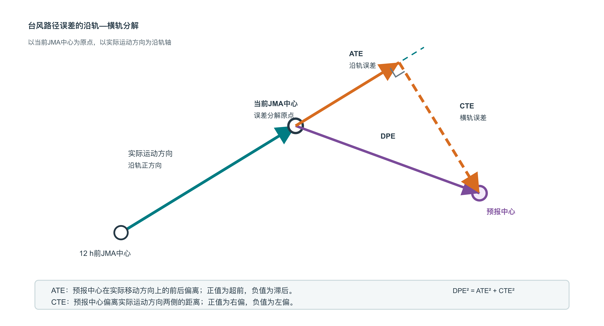

**图2-1 台风路径误差的沿轨与横轨分解。** 以当前JMA中心为原点，12 h前JMA中心至当前JMA中心的方向为沿轨正方向。当前JMA中心至预报中心的DPE向量投影到沿轨轴，得到ATE；投影到垂直于沿轨轴的方向，得到CTE。

在每个验证时刻，计算当前JMA中心指向12 h前中心的球面初始方位角，再旋转180°，作为当前运动参考方向 $\alpha$。若12 h位移不足10 km或所需记录缺失，则该记录不作方向分解，DPE仍保留。设当前JMA中心指向预报中心的初始方位角为 $\beta$，则

$$
\mathrm{ATE}=E\cos(\beta-\alpha),\qquad
\mathrm{CTE}=E\sin(\beta-\alpha).
$$

沿轨误差ATE为正表示超前、为负表示滞后；横轨误差CTE为正表示相对运动方向右偏、为负表示左偏。分别报告有符号均值与绝对值均值：前者反映总体偏向，后者反映偏离大小。每条有效记录满足 $\mathrm{ATE}^2+\mathrm{CTE}^2=E^2$，据此定义沿轨平方误差占比

$$
F_{\mathrm{ATE}}=
\frac{\langle\mathrm{ATE}^2\rangle}
{\langle\mathrm{ATE}^2\rangle+\langle\mathrm{CTE}^2\rangle},
$$

其中 $\langle\cdot\rangle$ 表示在同一有效记录集合上按台风等权平均。该分解把“预报中心错了多远”转化为“主要错在实际移动方向的前后，还是路径两侧”。当平均绝对ATE大于平均绝对CTE时，误差主要表现为沿实际移动方向的前后错位；后续转向分析据此检验这种错位在转向前后是否改变。

#### 2.2.4 转向识别与两类比较

转向按JMA路径识别。对候选时刻，要求此前24 h向西移动至少1°经度，此后24 h向东移动至少1°经度，两个窗口均向北移动；此前两个12 h时段的经度变化均不为正，此后两个12 h时段均不为负。若存在多个候选点，选最靠西者，经度相同则选最早者。


**图2-2 本文的台风转向判定示意图。** 从下向上沿箭头阅读，圆点表示每6 h的中心位置，$t_0$ 为转向时刻。转向前24 h向西移动至少1°经度，转向后24 h向东移动至少1°经度，前后两个窗口均向北移动；四个12 h时段另须满足图示的经度方向条件。右侧列出位移、方向及多个候选点的筛选规则。图中路径为规则示意，不对应实际台风。

整段路径中满足条件的台风归为转向组，其余归为未转向组。一个台风的全部案例沿用台风分组，并额外记录预报窗口是否包含转向时刻。

组间分析首先比较同一个模型在两类台风中的平均误差。对模型 $m$ 和预报时效 $\tau$，以DPE为例，组间差值定义为

$$
G_m(\tau)
=\overline E_{m,\mathrm{转向}}(\tau)
-\overline E_{m,\mathrm{未转向}}(\tau).
$$

其中，$\overline E_{m,\mathrm{转向}}(\tau)$ 和 $\overline E_{m,\mathrm{未转向}}(\tau)$ 分别为模型 $m$ 在两组中的台风等权平均DPE：先对同一台风的有效案例取平均，再对组内台风等权平均。$G_m(\tau)>0$ 表示该模型在转向组的平均DPE更大，$G_m(\tau)<0$ 表示在未转向组的平均DPE更大，单位为km。平均绝对ATE和平均绝对CTE的组间差值沿用同一计算方式，将DPE分别替换为 $|\mathrm{ATE}|$ 和 $|\mathrm{CTE}|$。

随后比较模型配对差值在两组之间的差异。例如GraphCast−Pangu的组间差异为

$$
I(\tau)=\widehat\Delta_{\mathrm{转向}}^{\mathrm{GC-P}}(\tau)
-\widehat\Delta_{\mathrm{未转向}}^{\mathrm{GC-P}}(\tau).
$$

该量检验两模型的平均差距是否随路径类型改变。组间分析在两组内分别有放回抽取整台风，保留相同模型与时效的配对关系，重复20 000次。针对DPE、平均绝对ATE、平均绝对CTE，将比较分为三类：组间差180项、组内模型配对360项，以及模型配对差的组间交互180项。每类分别构建近似95%同时置信带，控制该类比较的整体多重比较误差。

另以 $[\overline E(120)-\overline E(24)]/96$ 表示24–120 h的平均误差端点增长率，即两个时效的平均DPE之差除以相隔的96 h，单位为km/h。

#### 2.2.5 转向阶段的配对比较

本节用于判断模型的预测能力在台风转向前后是否发生明显变化。以JMA路径确定的转向时刻为零点，将验证时刻划分为转向前 $[-24,-12]$ h、转向附近 $[-6,6]$ h 和转向后 $[12,24]$ h三个阶段。主分析使用转向前起报的完整案例，比较相同台风、相同模型和相同预报时效下的转向前后误差。

设台风 $i$ 的转向时刻为 $r_i$，案例 $j$ 的起报时刻为 $t_{ij}$，预报时效为 $\tau$，则该记录的验证时刻相对转向时刻为

$$
q_{ij}(\tau)=t_{ij}+\tau-r_i.
$$

这里固定的是预报时效 $\tau$。例如，两个不同起报案例都使用48 h预报，但一个案例的验证时刻可能落在转向前，另一个案例的验证时刻可能落在转向后。对指标 $Y$（分别取DPE、$|\mathrm{ATE}|$ 或 $|\mathrm{CTE}|$），定义转向前和转向后的案例集合为

$$
\mathcal J_{i}^{\mathrm{pre}}(\tau)=\{j:q_{ij}(\tau)\in[-24,-12]\},
\qquad
\mathcal J_{i}^{\mathrm{post}}(\tau)=\{j:q_{ij}(\tau)\in[12,24]\}.
$$

在同一台风、同一模型和同一预报时效下，分别计算两个阶段的平均误差：

$$
\overline Y_{im}^{\mathrm{pre}}(\tau)
=\frac{1}{|\mathcal J_{i}^{\mathrm{pre}}(\tau)|}
\sum_{j\in\mathcal J_{i}^{\mathrm{pre}}(\tau)}Y_{ijm}(\tau),
$$

$$
\overline Y_{im}^{\mathrm{post}}(\tau)
=\frac{1}{|\mathcal J_{i}^{\mathrm{post}}(\tau)|}
\sum_{j\in\mathcal J_{i}^{\mathrm{post}}(\tau)}Y_{ijm}(\tau).
$$

当两个阶段都存在记录时，计算该台风在预报时效 $\tau$ 下的阶段差值：

$$
\delta_{im}^{Y}(\tau)
=\overline Y_{im}^{\mathrm{post}}(\tau)
-\overline Y_{im}^{\mathrm{pre}}(\tau).
$$

$\delta_{im}^{Y}(\tau)>0$ 表示转向后误差增大，$\delta_{im}^{Y}(\tau)<0$ 表示转向后误差减小。设台风 $i$ 能够同时获得前后阶段记录的预报时效集合为 $\mathcal T_{im}^{Y}$，先在台风内对这些时效等权平均：

$$
\delta_{im}^{Y}
=\frac{1}{|\mathcal T_{im}^{Y}|}
\sum_{\tau\in\mathcal T_{im}^{Y}}
\delta_{im}^{Y}(\tau).
$$

比较指标为DPE、平均绝对ATE和平均绝对CTE。前面的计算已经得到每个台风在每个模型、每种指标下的台风级阶段差值 $\delta_{im}^{Y}$。因此，5个转向台风各对应一个九维结果向量，九个坐标分别对应3个模型和3种指标：

$$
\boldsymbol\delta_i=
\bigl(\delta_{i,\mathrm{GC}}^{\mathrm{DPE}},
\delta_{i,\mathrm{Pangu}}^{\mathrm{DPE}},
\delta_{i,\mathrm{FCN}}^{\mathrm{DPE}},
\delta_{i,\mathrm{GC}}^{|\mathrm{ATE}|},
\delta_{i,\mathrm{Pangu}}^{|\mathrm{ATE}|},
\delta_{i,\mathrm{FCN}}^{|\mathrm{ATE}|},
\delta_{i,\mathrm{GC}}^{|\mathrm{CTE}|},
\delta_{i,\mathrm{Pangu}}^{|\mathrm{CTE}|},
\delta_{i,\mathrm{FCN}}^{|\mathrm{CTE}|}\bigr).
$$

五个台风的原样本均值组成总体阶段变化向量。令 $k=1,\ldots,9$ 表示一个模型—指标坐标，则

$$
\widehat\Delta_k=\frac{1}{5}\sum_{i=1}^{5}\delta_{ik}.
$$

设第 $b$ 次重采样抽到的台风编号序列为

$$
I^{(b)}=(I_1^{(b)},I_2^{(b)},I_3^{(b)},I_4^{(b)},I_5^{(b)}),
\qquad I_\ell^{(b)}\in\{1,2,3,4,5\}.
$$

例如，序列可以是“2509、2509、2519、2523、2526”，表示KROSA被抽到两次，其余三个台风各抽到一次。根据同一组序列，同时重新计算9个坐标的平均值：

$$
\widehat\Delta_k^{*(b)}
=\frac{1}{5}\sum_{\ell=1}^{5}
\delta_{I_\ell^{(b)},k}.
$$

一个序列同时产生9个重采样平均值，序列中台风的重复次数同时作用于这9个坐标。每次从5个台风中有放回抽取5个，共有 $5^5=3125$ 个等概率序列。对固定坐标 $k$ 收集3125个 $\widehat\Delta_k^{*(b)}$，取第2.5和第97.5百分位数，得到该模型—指标组合的逐项95%置信区间。

同时置信带使用每个序列在9个坐标上的共同变化。先根据5个台风级结果计算标准误

$$
\widehat{\mathrm{SE}}_k=
\frac{1}{\sqrt{4}}
\left[\sum_{i=1}^{5}(\delta_{ik}-\widehat\Delta_k)^2\right]^{1/2},
$$

再对第 $b$ 个序列计算9个标准化偏差并取最大值：

$$
M^{*(b)}
=\max_{k=1,\ldots,9}
\left|
\frac{\widehat\Delta_k^{*(b)}-\widehat\Delta_k}
{\widehat{\mathrm{SE}}_k}
\right|.
$$

取3125个 $M^{*(b)}$ 的第95百分位数为共同临界值 $q_{0.95}$，对9个坐标统一使用：

$$
\left[
\widehat\Delta_k-q_{0.95}\widehat{\mathrm{SE}}_k,
\quad
\widehat\Delta_k+q_{0.95}\widehat{\mathrm{SE}}_k
\right].
$$

逐项区间分别评价9个模型—指标组合；同时置信带先在每个序列中找出9个坐标里最极端的偏差，再用这个共同标准评价全部9个组合。

为检验阶段比较是否依赖具体分析设定，补充设置了逐一删除台风、扩大或缩小阶段窗口、纳入全部起报案例、限定共同有效记录以及更换运动参考方向等敏感性分析。比较不同方向定义时，仅使用各方法均可计算的记录；各项设置及计算步骤见附录。

另将13个截短台风作为单独的补充样本。在这13个台风全部可验证的6–36 h，沿用相同的误差和台风等权定义，报告三模型均值、配对差、方向分量及6–36 h端点变化；重采样单位仍为台风，三模型配对×六时效使用18项近似同时带。完整14台风同时按全部案例和每台风首个完整案例计算，用于检查起报次数差异。42–78 h只逐时效列出有效台风数及描述均值，不把样本组成变化解释为同一批台风的连续误差增长。截短台风各仅有一个起报，无法建立同台风、同lead的转向前后配对；没有一个截短案例到120 h。

#### 2.2.6 模型分歧、相关关系与留出台风检验

本节从相关关系和风险识别两个层面评价模型分歧：先检验同一预报时效下，分歧较大的案例是否通常具有较大的共识误差；再检验高分歧筛选后的案例中，大误差是否更加集中。主分析使用14个台风、74个完整起报案例，覆盖6–120 h的20个时效，各台风总权重相同。

**（1）模型分歧与共识误差。** 对于同一次起报、同一预报时效，三个模型分别给出中心 $P_1,P_2,P_3$。模型分歧定义为三个两两大圆距离的平均值：

$$
\mathrm{IMD}=\frac{d(P_1,P_2)+d(P_1,P_3)+d(P_2,P_3)}3.
$$

IMD越大，说明三个预测位置越分散。设三个预测中心对应的球面三维单位向量为 $\boldsymbol u_1,\boldsymbol u_2,\boldsymbol u_3$，共识位置的单位向量及其误差为

$$
\boldsymbol u_{\mathrm{con}}=
\frac{\sum_{m=1}^{3}\boldsymbol u_m}{\left\|\sum_{m=1}^{3}\boldsymbol u_m\right\|},
\qquad D_c=d(P_{\mathrm{con},c},P_{\mathrm{JMA},c}).
$$

其中，$P_{\mathrm{con},c}$ 为单位向量转换得到的共识经纬度，$D_c$ 为案例 $c$ 的共识DPE。IMD由三模型预报结果直接计算，共识DPE用于事后检验。

**（2）逐时效相关关系。**

每个预报时效分别计算IMD与共识DPE的加权秩相关。设台风 $s$ 在该时效有 $n_s$ 个有效案例，则该台风的每个案例赋予权重

$$
w_c=\frac{1}{n_s},\qquad
\widetilde w_c=\frac{w_c}{\sum_{c'}w_{c'}}.
$$

因此每个台风的有效案例权重之和相同。例如，一个台风有4个案例、另一个台风有1个案例时，前者每个案例的权重为 $1/4$，两个台风的总权重都为1。对IMD和共识DPE分别计算加权中秩：

$$
R_x(c)=\sum_{c'}\widetilde w_{c'}\mathbf 1(x_{c'}<x_c)
 +\frac12\sum_{c'}\widetilde w_{c'}\mathbf 1(x_{c'}=x_c),
$$

其中 $x$ 表示IMD或共识DPE，等值记录取中间秩。分别记两者的秩为 $R_x$ 和 $R_y$，加权平均秩为 $\overline R_x=\sum_c\widetilde w_cR_x(c)$ 和 $\overline R_y=\sum_c\widetilde w_cR_y(c)$。对两组秩计算加权Pearson相关，即得到加权Spearman相关系数：

$$
\rho_w=
\frac{\sum_c\widetilde w_c(R_x(c)-\overline R_x)(R_y(c)-\overline R_y)}
{\sqrt{\sum_c\widetilde w_c(R_x(c)-\overline R_x)^2}
 \sqrt{\sum_c\widetilde w_c(R_y(c)-\overline R_y)^2}}.
$$

为比较同一预报时效下不同起报案例的分歧与误差是否相关，本文对6、12、……、120 h分别计算相关系数。每个时效回答的问题是：“在这一时效内，模型分歧较大的案例，实际共识路径误差是否也较大？”不把24 h和120 h的记录混在一起，是为了避免把二者共同随预报时效增加的变化误判为案例之间的相关关系。区间通过10000次台风重采样获得：每次有放回抽取14个台风，保留被抽中台风的全部案例，重新计算权重、加权秩和相关系数；取10000个相关系数的第2.5和97.5百分位数，得到逐项95%置信区间。

**（3）留出台风风险检验。** 风险检验采用留出台风方法。每次留出一个台风，用其余13个台风在时效 $\tau$ 上分别计算IMD和共识DPE的加权第75百分位数：

$$
q_{\mathrm{IMD},\tau}^{(-s)},\qquad
q_{\mathrm{DPE},\tau}^{(-s)}.
$$

对留出台风中的案例，定义高分歧预警和大误差事件：

$$
A_c=\mathbf 1\{\mathrm{IMD}_c>q_{\mathrm{IMD},\tau}^{(-s)}\},
\qquad
E_c=\mathbf 1\{\mathrm{DPE}_{\mathrm{consensus},c}>q_{\mathrm{DPE},\tau}^{(-s)}\}.
$$

其中 $A_c=1$ 表示发出预警，$E_c=1$ 表示该案例实际属于大误差事件。轮流留出14个台风后，在每个时效汇总所有留出记录，按台风等权计算识别指标。阈值按时效分别确定，各时效沿用第75百分位规则。

**（4）识别效果评价。** 命中率POD回答大误差中有多少被识别，虚警比例FAR回答发出的预警中有多少未对应大误差。使用案例权重 $w_c$ 后，两者分别为

$$
\mathrm{POD}=\frac{\sum_c w_c\mathbf 1(A_c=1,E_c=1)}{\sum_c w_c\mathbf 1(E_c=1)},
$$

$$
\mathrm{FAR}=\frac{\sum_c w_c\mathbf 1(A_c=1,E_c=0)}{\sum_c w_c\mathbf 1(A_c=1)}.
$$

AUC评价连续风险分数对大误差与普通案例的区分能力。对留出台风 $s$ 的案例，风险分数取 $S_c=\mathrm{IMD}_c/q_{\mathrm{IMD},\tau}^{(-s)}$，即用确定阈值的13个台风对分歧进行尺度统一。设 $\mathcal E$ 和 $\mathcal O$ 分别为大误差与普通案例集合，则

$$
\mathrm{AUC}=
\frac{\sum_{c\in\mathcal E}\sum_{d\in\mathcal O}w_cw_d
\left[\mathbf1(S_c>S_d)+\tfrac12\mathbf1(S_c=S_d)\right]}
{\left(\sum_{c\in\mathcal E}w_c\right)\left(\sum_{d\in\mathcal O}w_d\right)}.
$$

AUC越高，表示大误差案例越容易排在风险分数较高的位置；0.5对应随机排序的参考水平。

提升倍数评价高分歧筛选后大误差的集中程度。预警精确率 $\pi$、总体大误差发生率 $p_E$ 及提升倍数定义为

$$
\pi=\frac{\sum_c w_c A_cE_c}{\sum_c w_cA_c}=1-\mathrm{FAR},
\qquad p_E=\frac{\sum_c w_cE_c}{\sum_c w_c},
\qquad \mathrm{Lift}=\frac{\pi}{p_E}.
$$

例如，提升倍数为2，表示高分歧案例中的大误差比例为总体的2倍。AUC评价风险排序，POD与FAR评价阈值识别，提升倍数评价筛选收益，三者共同说明模型分歧的风险提示价值。

<a id="chapter3"></a>

## 第三章 平均误差的比较

本章沿着三个问题展开：

1. 平均路径误差有多大，随预报时效如何变化？
2. 大误差个例如何影响总体评价？
3. 哪些模型差距获得联合统计支持？

全部结果基于同一批14个台风、74个完整案例，按台风等权计算。全球数据驱动天气预报基准同样强调在统一资料、变量和预报时效下比较模型表现；本文将这一原则落实到同一批台风和配对起报案例。[[15]](#ref-15)[[16]](#ref-16)

### 3.1 平均路径误差随时效的变化

**GraphCast在较短时效的样本平均误差最小，Pangu-Weather在较长时效最小。** 三模型的平均DPE总体随预报时效增大，GraphCast在6–66 h最小，Pangu-Weather在72–120 h最小；FourCastNet在表3-1所列时效均为三者中最大。120 h时，GraphCast、Pangu-Weather和FourCastNet的平均DPE分别为483.7、341.0和705.0 km（图3-1、表3-1）。

**Pangu-Weather在24–120 h的平均误差增量最小。** 按表3-1数值计算，GraphCast、Pangu-Weather和FourCastNet在这一时段分别增加411.5、242.4和598.9 km。Pangu-Weather在24 h的平均误差高于GraphCast，而到120 h更低，表现出较小的长时效误差累积。

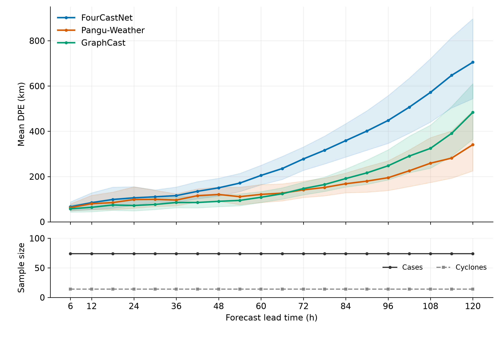

**图3-1 三模型的台风等权平均DPE及逐时效95%置信区间。** 横轴为起报后经过的小时数，纵轴为平均距离误差。曲线用于比较总体水平，模型间差异的统计判断见3.3节。

**表3-1 关键时效的平均DPE及逐时效95%置信区间，单位km。**

| 时效/h | GraphCast | Pangu-Weather | FourCastNet |
|---:|---:|---:|---:|
| 24 | 72.2 [48.5, 100.7] | 98.6 [60.1, 154.7] | 106.1 [72.8, 154.9] |
| 48 | 90.7 [67.0, 117.4] | 120.9 [90.8, 153.7] | 150.3 [113.4, 192.3] |
| 72 | 147.0 [118.9, 175.3] | 141.3 [107.3, 180.1] | 277.9 [227.3, 330.8] |
| 96 | 247.6 [185.0, 318.1] | 195.0 [138.2, 269.6] | 448.0 [346.2, 557.1] |
| 120 | 483.7 [365.1, 610.2] | 341.0 [224.9, 490.0] | 705.0 [543.8, 897.0] |

### 3.2 均方根误差与大偏差的影响

**对大偏差更敏感的RMSE在120 h给出与平均DPE一致的模型排序。** GraphCast、Pangu-Weather和FourCastNet的RMSE分别为576.4、445.2和859.3 km，由小到大依次为Pangu-Weather、GraphCast、FourCastNet。RMSE通过先平方、再平均和开方，提高了大偏差对总体指标的影响，计算方法见第2.2.1节。

**表3-2 关键时效的台风等权距离RMSE及逐时效95%置信区间。** RMSE单位为km；末行为120 h的RMSE与平均DPE之比，无量纲。使用与表3-1相同的归档案例计算。

| 时效/h或比值 | GraphCast | Pangu-Weather | FourCastNet |
|---:|---:|---:|---:|
| 24 | 95.1 [59.0, 128.8] | 144.6 [75.4, 214.2] | 150.1 [83.9, 210.3] |
| 48 | 110.9 [79.7, 140.7] | 151.1 [111.3, 185.6] | 186.2 [137.5, 236.8] |
| 72 | 170.7 [139.7, 198.6] | 171.4 [127.5, 215.0] | 319.3 [259.5, 375.0] |
| 96 | 303.3 [224.2, 379.2] | 253.7 [166.2, 348.8] | 530.8 [404.4, 649.4] |
| 120 | 576.4 [445.6, 703.5] | 445.2 [268.4, 625.5] | 859.3 [643.3, 1083.5] |
| 120 h RMSE/平均DPE（无量纲） | 1.19 | 1.31 | 1.22 |

**Pangu-Weather在120 h的平均误差最小，但各案例的误差分布更不均匀。** 其RMSE与平均DPE之比为1.31，高于GraphCast的1.19和FourCastNet的1.22，表明各案例误差相对于自身平均水平的波动更大。

**HALONG是Pangu-Weather在120 h最突出的高误差个例，删除后模型的样本排序仍保持不变。** HALONG的4个完整案例平均DPE为1086.3 km，约为14个台风平均值的3.2倍。删除HALONG后，Pangu-Weather的平均DPE降至283.6 km，仍低于GraphCast和FourCastNet。该个例抬高了Pangu-Weather的总体误差；其对均方误差和平均DPE的贡献推导及删除结果见附录A.2。

平均DPE与RMSE的排序交叉分别出现在66–72 h和72–78 h，两个指标均显示GraphCast与Pangu-Weather在72 h附近发生样本排序变化（图3-2）。

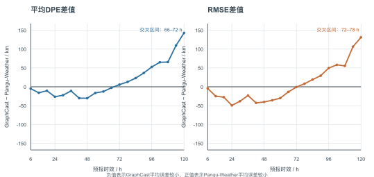

**图3-2 GraphCast−Pangu-Weather的平均DPE差值与RMSE差值。** 横轴为预报时效，纵轴为GraphCast减Pangu-Weather；负值表示GraphCast误差更小，正值表示Pangu-Weather误差更小。左图为平均DPE差值，右图为RMSE差值；零线标出样本排序交叉所在的时效区间。

### 3.3 模型间配对差异及排序变化

**GraphCast与Pangu-Weather的样本平均误差排序在72 h附近发生交叉。** GraphCast−Pangu-Weather的平均DPE差值在66–72 h之间由负变正，对应GraphCast在较短时效误差较小、Pangu-Weather在较长时效误差较小。120 h时，Pangu-Weather的平均DPE比GraphCast低142.7 km。该差值的同时置信区间为[−3.0, 288.5] km，两模型全部20个时效的同时置信带均包含零，因此上述交叉体现为样本平均排序的变化，尚未获得优势转换的联合统计支持（表3-3）。

**表3-3 关键时效GraphCast−Pangu-Weather的平均DPE差值及区间，单位km。** 同时置信带覆盖三组模型配对与20个时效，共60项比较。

| 时效/h | 平均差值 | 逐时效95%区间 | 近似95%同时置信带 |
|---:|---:|---:|---:|
| 24 | −26.4 | [−83.5, 11.6] | [−103.2, 50.4] |
| 48 | −30.3 | [−61.7, −4.8] | [−74.6, 14.1] |
| 72 | 5.8 | [−34.5, 39.5] | [−51.9, 63.5] |
| 96 | 52.6 | [−5.5, 103.6] | [−31.4, 136.7] |
| 120 | 142.7 | [52.6, 239.9] | [−3.0, 288.5] |

**GraphCast和Pangu-Weather相对FourCastNet的中长时效优势获得了联合统计支持。** 在54–114 h，两者的平均DPE均小于FourCastNet，对应配对差值的同时置信带均完全低于零；120 h时，只有Pangu-Weather相对FourCastNet的优势仍获得支持。该时效Pangu-Weather的平均DPE比FourCastNet低364.0 km，降幅为51.6%（图3-3）。

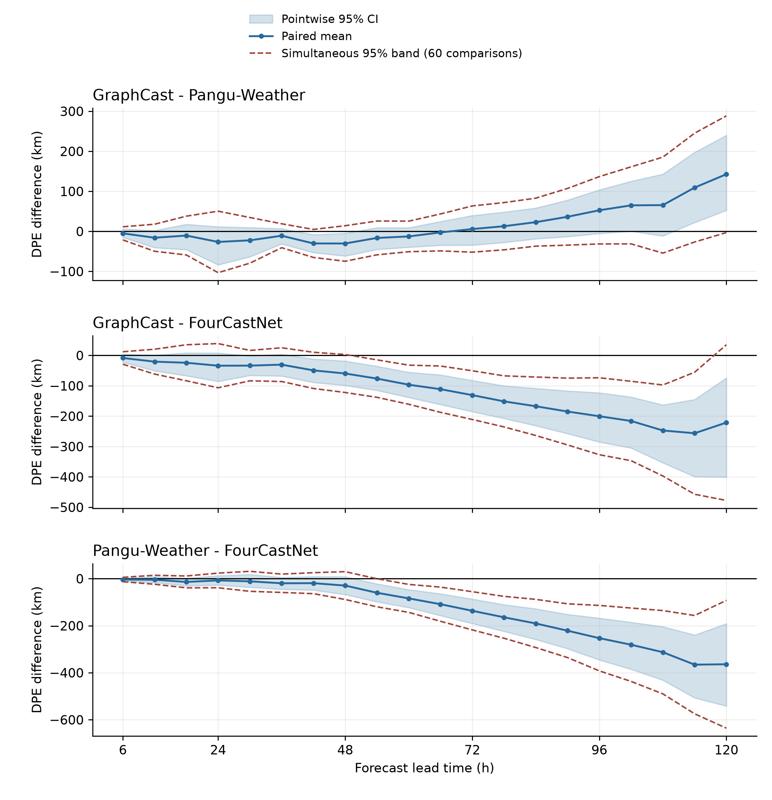

**图3-3 三组模型配对的平均DPE差值。** 负值表示标题中前一个模型误差较小；蓝色阴影为逐时效区间，红色虚线为覆盖60项比较的同时置信带。

### 3.4 本章小结

1. **总体表现随时效变化。** GraphCast在6–66 h的样本平均误差最小，Pangu-Weather在72–120 h最小。
2. **平均水平与个例波动需要一起看。** Pangu-Weather在120 h平均DPE最小，RMSE/平均DPE比值也最高，HALONG是其最突出的高误差个例。
3. **联合统计支持的是相对FourCastNet的优势。** GraphCast在54–114 h、Pangu-Weather在54–120 h获得支持；GraphCast与Pangu-Weather的排序交叉未获同时置信带支持。


<a id="chapter4"></a>

## 第四章 台风路径变化的评估

本章沿着四个问题展开：

1. 预报中心通常偏在实际路径的哪个方向？
2. 哪些台风在最佳路径中发生了可识别的转向？
3. 转向前后，模型的预报误差是否发生变化，即转向过程是否会影响路径预报能力？
4. 转向类台风与其余台风的差异是否因模型而异？


### 4.1 沿轨与横轨误差的方向特征

以JMA最佳路径中心为原点，沿其回看12 h的运动方向分解预测位置误差。沿轨误差（ATE）为正表示中心超前、为负表示滞后；横轨误差（CTE）为正表示位于运动方向右侧、为负表示左侧。这种分解已用于热带气旋多模式集合预报的路径验证，可分别识别移动快慢偏差与左右偏差。[[20]](#ref-20) 绝对值反映偏离大小，有符号均值反映平均偏向。回看12 h位移不足10 km或缺少位置时不作方向分解，但仍计入DPE。三个模型与20个时效均先在台风内平均滚动起报，再让14个台风等权；同一个误差方向的模型比较使用相同有效案例。

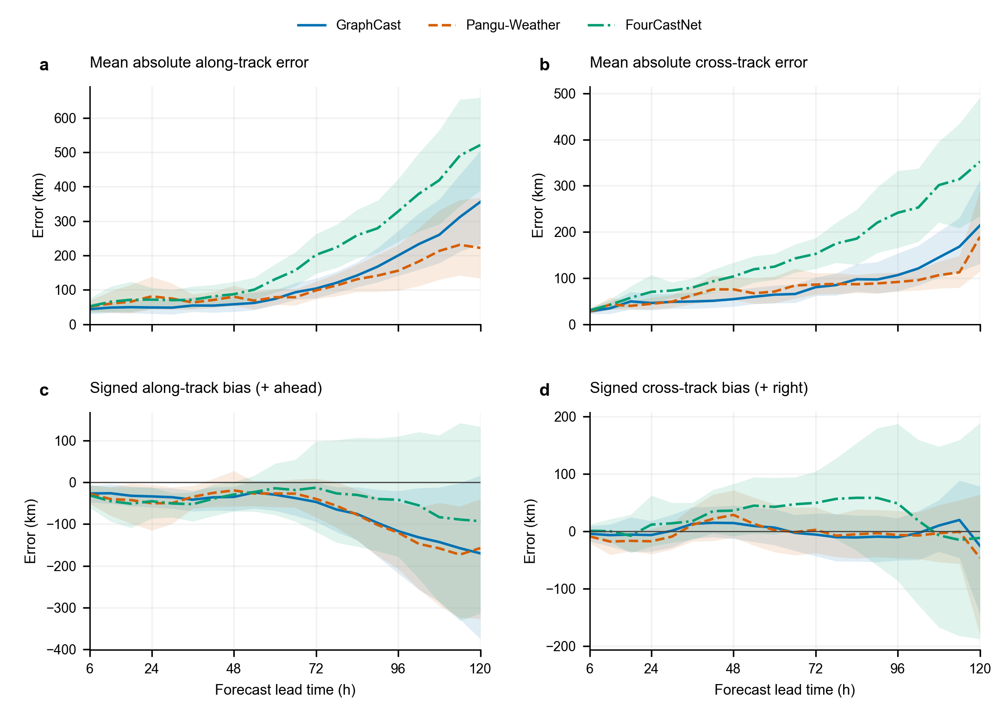

**图4-1 沿轨和横轨误差随预报时效的变化。** 上排是平均绝对偏离，下排是有符号平均偏差；阴影为台风重采样的逐时效95%区间。图表所用统计表与绘图程序见[附录C.2](#appendix-c2)。各时效分量只在可定义方向的记录上计算。

**表4-1 120 h的沿轨与横轨误差分量，单位km。** 数值来自逐时效统计表（见[附录C.2](#appendix-c2)）。

| 模型 | 平均绝对ATE | 平均绝对CTE | 平均ATE | 平均CTE |
|---|---:|---:|---:|---:|
| GraphCast | 355.9 | 214.1 | −170.0 | −25.2 |
| Pangu-Weather | 222.1 | 189.6 | −157.5 | −46.2 |
| FourCastNet | 521.3 | 352.3 | −93.0 | −11.4 |

图4-1a、b显示，三模型的沿轨和横轨误差总体随预报时效延长而增大。72–120 h内，三个模型的平均绝对沿轨误差均大于平均绝对横轨误差，说明长时效的位置偏离更多表现为沿实际运动方向的前后错位。120 h时，三模型的沿轨分量分别比横轨分量高141.7、32.5和169.0 km。

进一步看有符号沿轨误差，三模型在6–120 h的平均ATE始终为负，说明上述沿实际运动方向的前后错位主要表现为预测中心落后于实际中心（图4-1c）。120 h时，GraphCast、Pangu-Weather和FourCastNet的平均ATE分别为−170.0、−157.5和−93.0 km。相比之下，平均CTE在零线两侧变化，没有形成贯穿全部时效的固定左偏或右偏（图4-1d）。

### 4.2 台风转向的识别与样本划分

转向只根据JMA最佳路径判定，不根据模型误差选择案例。本文沿用第二章预设的规则：候选时刻前24 h至少向西移动1°经度，后24 h至少向东移动1°经度，两个窗口均向北移动；前后各两个12 h子窗口还须分别维持相应经度方向。只在连续、等级符合条件的最佳路径上搜索；多个候选点取最靠西、再取最早者。**主分析14个台风中，KROSA（2509）、NEOGURI（2519）、HALONG（2522）、NAKRI（2523）及FUNG-WONG（2526）被归入转向组，共35个完整案例；其余9个台风、39个案例归入未转向组**。判定依据见[附录C.2](#appendix-c2)所列的逐台风判定表和候选时刻表。

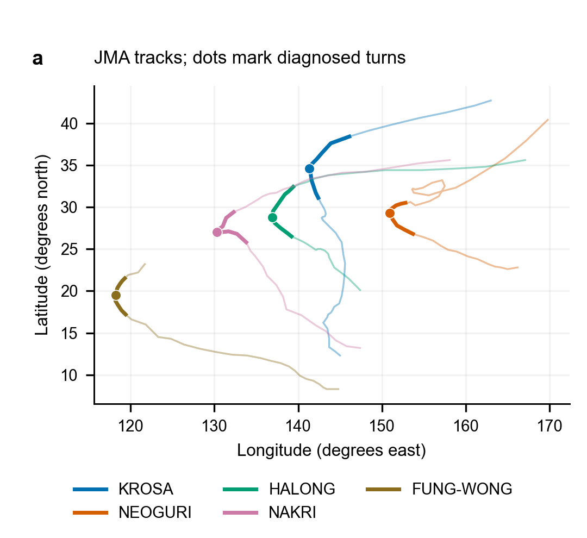

**图4-2a 五个转向台风的JMA路径与转向位置。** 圆点表示按固定规则识别的转向时刻，加粗线段表示转向时刻前后24 h的路径。程序与数据见[附录C.2](#appendix-c2)。

### 4.3 转向前后的误差变化

4.2节根据整段路径形态识别了转向台风。要判断转向过程是否影响路径预报能力，需要以转向时刻为基准，在相同预报时效下比较同一台风转向前后的误差。图4-2b和表4-2给出了可以开展这一比较的时效。

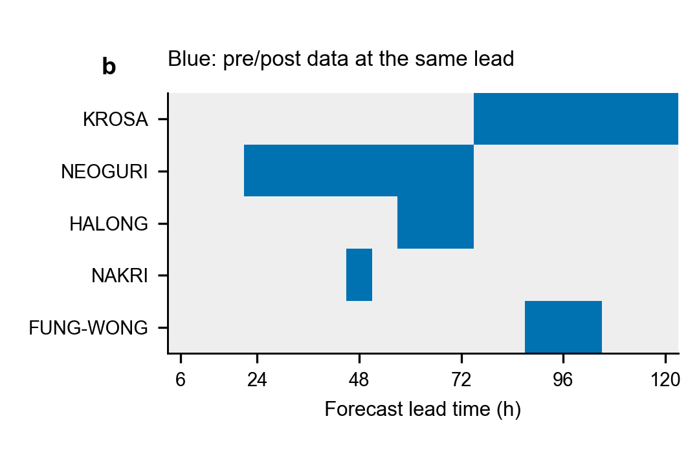

**图4-2b 转向前后可配对的预报时效。** 蓝格表示该台风在同一预报时效下同时具有转向前和转向后记录，可以计算该时效的前后误差差值。程序与数据见[附录C.2](#appendix-c2)。

**表4-2 转向前后比较的实际支持度。** “可匹配时效数”是同一台风在该预报时效下同时有前后阶段记录的时效数。程序与数据见[附录C.2](#appendix-c2)。

| 台风 | 完整案例数 | 可匹配时效数 | 可匹配时效范围 |
|---|---:|---:|---:|
| KROSA（2509） | 12 | 8 | 78–120 h |
| NEOGURI（2519） | 12 | 9 | 24–72 h |
| HALONG（2522） | 4 | 3 | 60–72 h |
| NAKRI（2523） | 3 | 1 | 48 h |
| FUNG-WONG（2526） | 4 | 3 | 90–102 h |

以验证时刻减JMA转向时刻为相对时间 $r$，转向前为 $r\in[-24,-12]$ h，转向附近为 $r\in[-6,6]$ h，转向后为 $r\in[12,24]$ h；只使用起报早于转向时刻的案例。对每个台风、每个模型和每个蓝格时效，分别求转向前、转向后的平均误差，再求“后−前”；同一台风的各蓝格时效取平均后，5个台风等权。表4-2显示，5个台风共提供24个台风×时效单元，同一预报时效最多有2个台风同时具备前后记录，因此五台风均值反映的是各台风在自身可匹配时效内的平均阶段变化。转向附近阶段只用于描述，不参与后−前差值。

比较指标为DPE、平均绝对ATE和平均绝对CTE，三个模型各一组，共9个量。以台风为单位对5个转向台风有放回重采样，共有 $5^5=3125$ 种等概率抽样序列，全部枚举；同一抽样同时计算9个量，得到逐项95%区间和9项近似95%同时置信区间（表4-3）。

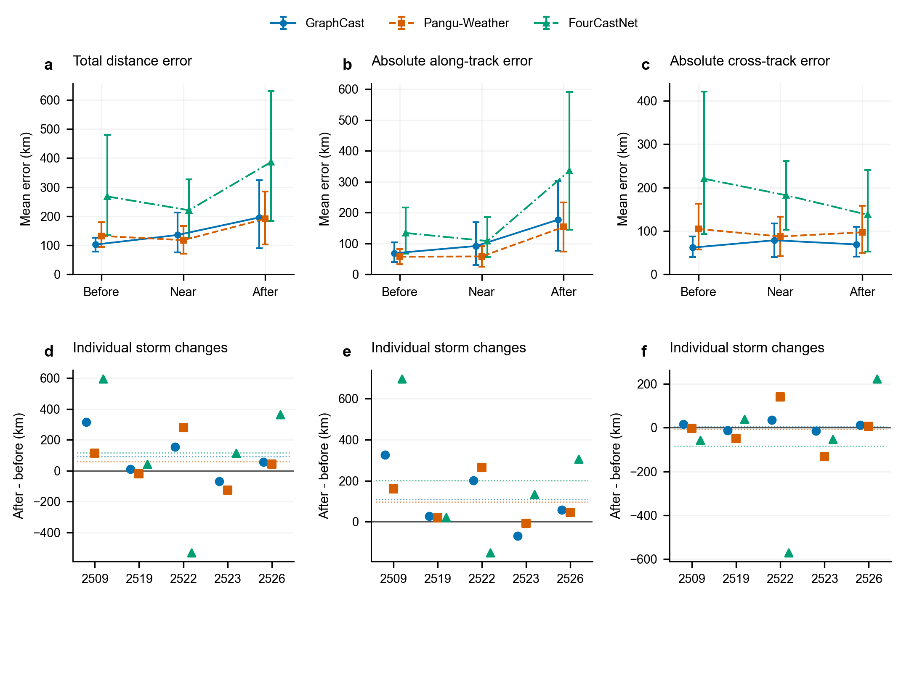

**图4-3a 转向前、附近、后的样本均值与逐台风变化。** 上排在三阶段都有数据的共同支持单元上绘制平均误差及逐项95%区间；下排各点是一个台风在可匹配时效中的“后−前”均值，虚线为五台风均值，横线0表示没有平均变化。横轴编号2509、2519、2522、2523、2526分别对应KROSA、NEOGURI、HALONG、NAKRI、FUNG-WONG。程序与数据见[附录C.2](#appendix-c2)。

**表4-3 同台风、相同时效的转向后减转向前误差，单位km。** 方括号依次为逐项95%百分位区间和9项同时置信带。正数表示转向后平均误差较大。阶段推断结果及文件位置见[附录C.2](#appendix-c2)。

| 模型 | 指标 | 平均后−前 | 逐项95%区间 | 9项同时区间 | 正差台风数 |
|---|---|---:|---:|---:|---:|
| GraphCast | DPE | +93.3 | [−12.3, 218.7] | [−47.3, 234.0] | 4/5 |
| GraphCast | 绝对ATE | +108.5 | [−5.3, 241.7] | [−39.6, 256.7] | 4/5 |
| GraphCast | 绝对CTE | +7.2 | [−8.9, 23.3] | [−13.3, 27.7] | 3/5 |
| Pangu-Weather | DPE | +58.8 | [−56.0, 185.6] | [−85.7, 203.4] | 3/5 |
| Pangu-Weather | 绝对ATE | +96.6 | [14.0, 195.1] | [−11.8, 204.9] | 4/5 |
| Pangu-Weather | 绝对CTE | −7.6 | [−80.4, 75.6] | [−102.1, 86.9] | 2/5 |
| FourCastNet | DPE | +117.8 | [−236.3, 410.7] | [−284.4, 520.1] | 4/5 |
| FourCastNet | 绝对ATE | +201.3 | [−25.0, 471.7] | [−106.3, 509.0] | 4/5 |
| FourCastNet | 绝对CTE | −83.2 | [−345.8, 113.2] | [−364.2, 197.8] | 2/5 |

**转向后的平均DPE更大。** 三个模型转向后的平均DPE均高于转向前，GraphCast、Pangu-Weather和FourCastNet分别增加93.3、58.8和117.8 km，其中，GraphCast和FourCastNet各有4个台风的平均DPE增大，Pangu-Weather有3个。GraphCast和FourCastNet在KROSA上的增幅最大，分别为+314.6和+595.8 km；Pangu-Weather在HALONG上的增幅最大，为+280.1 km。反向个例包括NAKRI（GraphCast −68.7 km，Pangu-Weather −125.0 km）和HALONG（FourCastNet −530.0 km）。逐一删除任一台风后，GraphCast和Pangu-Weather的平均DPE增幅仍为正；FourCastNet删除KROSA后为−1.7 km。逐台风表（见[附录C.2](#appendix-c2)）与删除检验表（见[附录C.2](#appendix-c2)）保留全部结果。转向附近阶段，Pangu-Weather和FourCastNet的平均DPE低于转向前，而转向后12–24 h的平均DPE高于转向前（图4-3a上排）。

**增大集中在沿轨方向。** 平均绝对ATE的后−前差值在三个模型中均为正（+108.5、+96.6和+201.3 km），每个模型都有4个台风增大；平均绝对CTE的变化方向不一（+7.2、−7.6和−83.2 km），三个模型分别有3、2、2个台风增大。统计3个模型×5个台风共15个组合，绝对ATE增大的有12个，DPE增大的有11个，绝对CTE增大的有7个。按逐时刻运动方向分解，转向后预测中心与实际中心的错位更多表现为沿运动方向的前后偏离，横向偏离没有一致增大。

**多数可配对时效单元在转向后出现更大的DPE和沿轨偏离。** 图4-3b逐一展示每个台风、每个可配对时效的“转向后−转向前”差值。每个模型均有24个台风×时效单元，GraphCast、Pangu-Weather和FourCastNet的DPE正差单元分别为17、19和18个，绝对ATE正差单元分别为19、20和17个；绝对CTE正差单元分别为10、9和12个。这些计数作为台风等权结果的分布佐证。KROSA、NEOGURI、HALONG、NAKRI和FUNG-WONG分别提供8、9、3、1和3个单元，统计推断以5个台风等权计算。

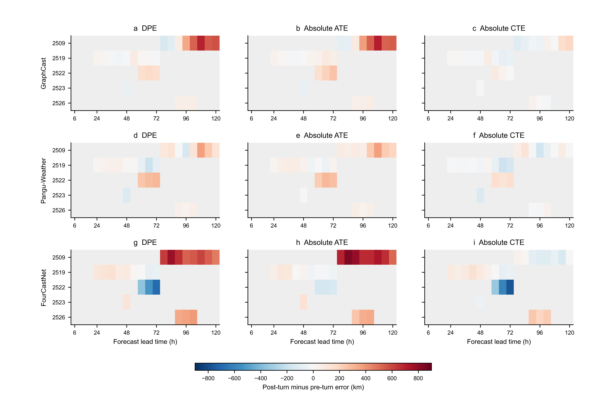

**图4-3b 逐台风、逐配对时效的转向后减转向前误差。** 三行分别为GraphCast、Pangu-Weather和FourCastNet，三列分别为DPE、平均绝对ATE和平均绝对CTE。每个色格对应一个台风在一个预报时效下的阶段平均差值，红色表示转向后较大，蓝色表示较小，浅灰色表示该时效无法配对；各面板使用相同色标。台风编号2509、2519、2522、2523和2526依次对应KROSA、NEOGURI、HALONG、NAKRI和FUNG-WONG。程序与数据见[附录C.2](#appendix-c2)。

**前后变化还具有清楚的台风差异。** KROSA在较长时效的DPE和沿轨误差增幅较大；HALONG在60–72 h的DPE变化则呈模型差异，GraphCast和Pangu-Weather为正，FourCastNet为负。图中按台风分行，保留每个台风的变化过程；各台风的时效差值先在台风内平均，再进入前述等权汇总。

**两种分解都显示转向后平均沿轨误差增大。** 转向过程中台风的运动方向发生改变，主分析按各验证时刻的运动方向分解误差，分解轴随之转动。把转向时刻的运动方向沿球面平行移动到各验证点、固定分解方向后，三个模型的平均绝对ATE后−前差值由+108.5、+96.6和+201.3 km降为+59.3、+14.4和+84.6 km，增量分别减少约45%、85%和58%。两种方向定义下，三个模型的平均绝对ATE均呈转向后增大，DPE保持不变。结果见设定敏感性表（见[附录C.2](#appendix-c2)）。

**参考方向改变的是误差分量，两个中心之间的距离保持不变。** 图4-3c将两种分解放在同一个位置误差上比较。主分析以验证时刻的运动方向为沿轨轴；对照分析将转向时刻的参考方向沿球面平行移动到当前JMA中心，再作为沿轨轴。两者都以当前JMA中心为原点，横轨轴均与沿轨轴垂直。实际中心和预测中心没有改变，因此DPE相同；参考方向改变后，同一误差在两个轴上的投影随之改变。

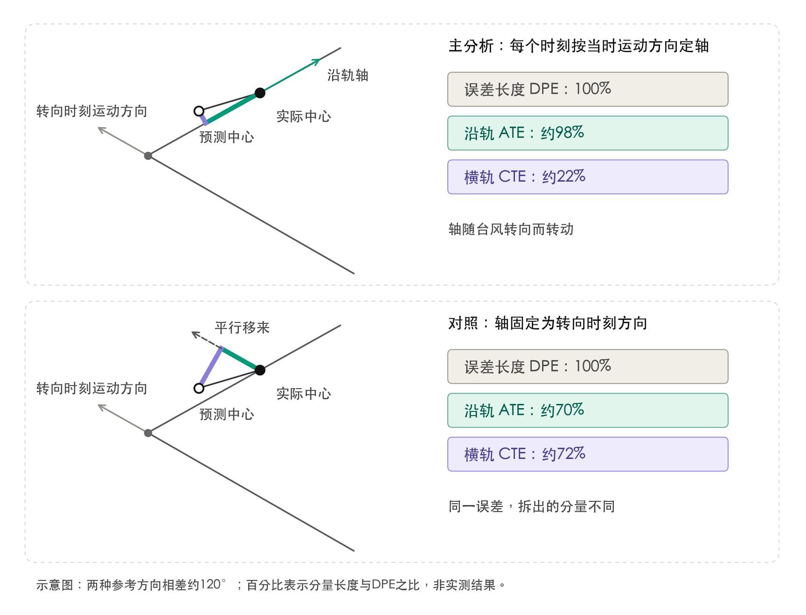

**图4-3c 两种运动参考方向下的误差分解示意。** 上图按当前运动方向定轴，下图将转向时刻的参考方向移到实际中心后定轴。两图中的实际中心、预测中心及其距离相同；绿色线段表示沿轨分量，紫色线段表示横轨分量。百分比表示分量的绝对长度与DPE之比：上图约为98%和22%，下图约为70%和72%。图中两种参考方向相差约120°，用于解释投影关系，非实测结果；实际计算采用球面平行移动。绘图源程序（见[附录C.2](#appendix-c2)）。

**本节小结：**

1. **转向后样本平均误差的增大主要表现为沿轨偏离增大。** 台风等权结果、逐时效分布和固定参考方向对照均呈现这一方向，横轨分量没有一致增大。
2. **GraphCast和Pangu-Weather的平均DPE增大不由单个台风决定，FourCastNet的平均增幅主要由KROSA贡献。** 逐一删除任一台风后，前两者的平均差仍为正；FourCastNet删除KROSA后接近零（−1.7 km）。

### 4.4 转向组与未转向组的误差差异

4.3节比较同一台风在转向前后的误差，本节比较转向台风与未转向台风在整个6–120 h预报过程中的表现。转向组为KROSA、NEOGURI、HALONG、NAKRI和FUNG-WONG共5个台风、35个完整案例，未转向组为其余9个台风、39个完整案例。各时效先对同一台风的案例取平均，再在组内按台风等权；组间差定义为“转向组−未转向组”。DPE与两个方向分量采用同一批方向分解有效记录。按组分别重采样整台风20 000次，对3模型×3指标×20时效共180项组间差构建近似95%同时置信带。

**两类台风的误差差距随预报时效展开，并非从短时效就保持同一方向。** FourCastNet的转向组平均DPE从36 h起持续高于未转向组；GraphCast在72–120 h持续为正，Pangu-Weather则在78–120 h持续为正。较短时效内，Pangu-Weather的转向组平均DPE反而较低。图4-4a展示两组误差水平，图4-4b直接展示两组差值及其区间。

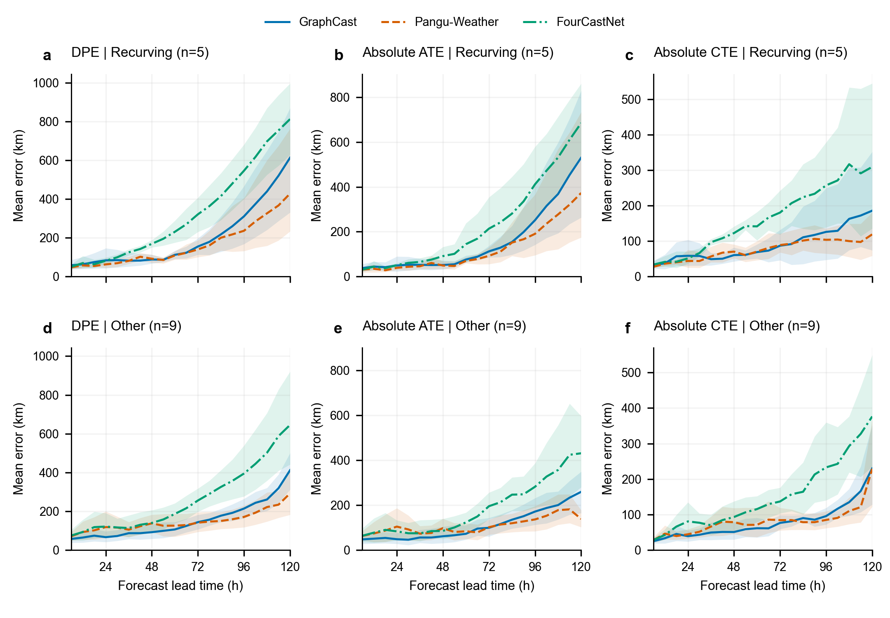

**图4-4a 转向组与未转向组的逐时效平均误差。** 上排为转向组5个台风，下排为未转向组9个台风；三列依次为DPE、平均绝对ATE和平均绝对CTE。曲线为台风等权平均，阴影为逐项95%区间。程序与数据见[附录C.2](#appendix-c2)。

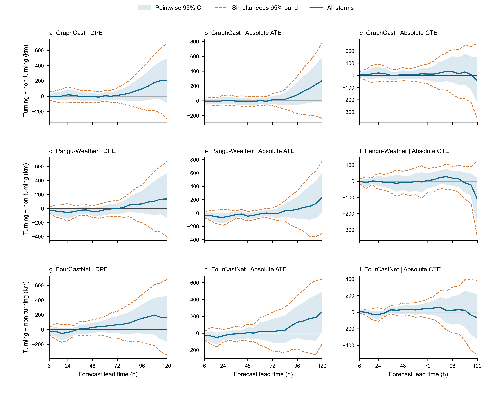

**图4-4b 6–120 h的组间误差差值。** 三行分别为GraphCast、Pangu-Weather和FourCastNet；蓝线为“转向组−未转向组”的平均差，浅蓝阴影为逐项95%区间，橙色虚线为覆盖全部180项比较的近似95%同时置信带。正值表示转向组较大，负值表示未转向组较大。程序与数据见[附录C.2](#appendix-c2)。 180项同时置信区间均包含零，曲线用于描述组间平均差随时效的变化。

**转向组较高的平均DPE主要出现在较长时效，末段差距最大。** 将全时效统一划分为6–48 h、54–96 h和102–120 h三个时段，先在每个台风内对时效取平均，再计算两组等权平均差（表4-4a）。6–48 h内，GraphCast的组间差接近零，Pangu-Weather和FourCastNet为负；54–96 h内，三个模型均转为正；102–120 h内，组间差分别扩大到178.7、116.8和175.8 km。这三个时段用于概括曲线的平均变化。

**表4-4a 分时段平均DPE及组间差，单位km。** 删除HALONG后，转向组由5个台风变为4个，未转向组保持9个。程序与数据见[附录C.2](#appendix-c2)。

| 时段 | 模型 | 转向组 | 未转向组 | 组间差 | 删除HALONG后的组间差 |
|---|---|---:|---:|---:|---:|
| 6–48 h | GraphCast | 77.6 | 75.0 | +2.6 | +9.8 |
| 6–48 h | Pangu-Weather | 71.4 | 108.1 | −36.8 | −32.8 |
| 6–48 h | FourCastNet | 100.7 | 113.3 | −12.6 | −9.8 |
| 54–96 h | GraphCast | 181.0 | 151.6 | +29.4 | +1.9 |
| 54–96 h | Pangu-Weather | 159.5 | 143.3 | +16.2 | −21.2 |
| 54–96 h | FourCastNet | 353.2 | 272.7 | +80.5 | +61.9 |
| 102–120 h | GraphCast | 487.3 | 308.6 | +178.7 | +83.6 |
| 102–120 h | Pangu-Weather | 351.9 | 235.1 | +116.8 | −22.2 |
| 102–120 h | FourCastNet | 720.7 | 544.9 | +175.8 | +115.7 |

**较长时效的组间差主要表现为沿轨偏离增大，横轨差异随时效变化。** 102–120 h内，三模型的平均绝对ATE组间差分别为196.6、139.2和189.5 km；平均绝对CTE组间差分别为+0.8、−32.2和−12.7 km。到120 h，三个模型的转向组绝对ATE均较大，绝对CTE均较小（表4-4b）。因此，末段较大的路径误差主要伴随沿运动方向的前后偏离；横轨差异在此前时效有正有负，到120 h三模型均为转向组较小。

**表4-4b 120 h两组平均误差及组间差，单位km。** 方括号为覆盖180项比较的近似95%同时置信区间。程序与数据见[附录C.2](#appendix-c2)。

| 模型 | 指标 | 转向组 | 未转向组 | 组间差及同时区间 |
|---|---|---:|---:|---:|
| GraphCast | DPE | 613.5 | 411.6 | +202.0 [−288.5, 692.5] |
| GraphCast | 绝对ATE | 529.9 | 259.2 | +270.7 [−236.2, 777.6] |
| GraphCast | 绝对CTE | 185.8 | 229.8 | −44.0 [−351.8, 263.8] |
| Pangu-Weather | DPE | 428.5 | 292.4 | +136.1 [−399.7, 671.9] |
| Pangu-Weather | 绝对ATE | 372.6 | 138.5 | +234.1 [−305.4, 773.6] |
| Pangu-Weather | 绝对CTE | 119.2 | 228.8 | −109.6 [−341.3, 122.1] |
| FourCastNet | DPE | 812.6 | 645.2 | +167.4 [−343.1, 678.0] |
| FourCastNet | 绝对ATE | 684.1 | 430.8 | +253.2 [−130.0, 636.4] |
| FourCastNet | 绝对CTE | 309.2 | 376.2 | −67.0 [−513.5, 379.5] |

**GraphCast和FourCastNet各有连续时段，组间DPE差的正方向不由任何单个台风决定。** 逐一删除14个台风中的任意一个，并在其所属组内重新计算台风等权平均，得到每个时效的14个组间差。GraphCast在84–120 h、FourCastNet在36–120 h的组间DPE差，在全部14次删除中始终为正。两模型的沿轨差也在末段保持同向：GraphCast在96–120 h、FourCastNet在90–120 h的平均绝对ATE组间差，在全部删除中均为正（图4-4c）。

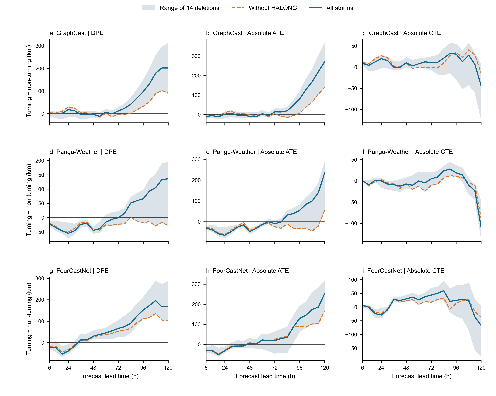

**图4-4c 组间差对单个台风的敏感性。** 蓝线为完整样本结果，灰色带为逐一删除14个台风所得组间差的最小值至最大值，橙色虚线为删除HALONG的结果。灰色带表示删除检验的结果范围；置信区间见图4-4b。灰色带整体位于零线上方，表示删除任意一个台风后转向组平均误差仍较高。程序与数据见[附录C.2](#appendix-c2)。

**HALONG抬高了三个模型的末段组间差，但只有Pangu-Weather在删除后发生平均差方向反转。** 102–120 h内，删除HALONG后，GraphCast的平均DPE组间差由178.7 km降至83.6 km，减少约53%；FourCastNet由175.8 km降至115.7 km，减少约34%；Pangu-Weather由116.8 km变为−22.2 km。HALONG对三个模型均有明显影响，GraphCast和FourCastNet删除后的转向组平均DPE仍较高，Pangu-Weather则转为较低。逐时效看，Pangu-Weather原来为正的78–120 h组间差，删除HALONG后除84 h外均变为负值；其102–120 h平均绝对ATE组间差也由+139.2 km变为−9.9 km。HALONG因此既解释了三模型末段差距的部分增幅，也解释了Pangu-Weather组间差方向对台风组成的依赖。

**72–120 h内，路径分组改变了模型之间的平均差距，但两组的模型排序一致。** 在这一区段的全部采样时效，两组内部均按Pangu-Weather、GraphCast、FourCastNet由小到大排列。120 h时，GraphCast−Pangu-Weather、GraphCast−FourCastNet和Pangu-Weather−FourCastNet的组间交互分别为+65.9、+34.5和−31.3 km：正值表示前一个模型相对后一个模型的误差差值在转向组更大，负值表示更小。三项交互的绝对值均小于单模型DPE组间差的最小值136.1 km，最大值65.9 km也不到其一半。就120 h的样本均值而言，路径分组主要体现为三模型共同较高的误差水平，同时伴随幅度较小的相对差距变化；这一比较回答了差异如何因模型而异（图4-5）。

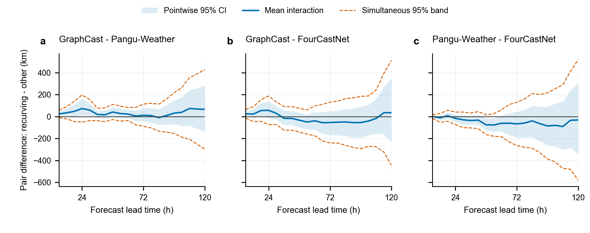

**图4-5 三组模型配对差的组间交互。** 零线表示两种路径类型中的模型平均差相同；蓝色为逐项区间，橙色虚线为覆盖3组模型配对×3指标×20时效共180项比较的近似95%同时置信带。程序与数据见[附录C.2](#appendix-c2)。 全部180项交互的同时置信区间均包含零，所报交互值描述样本平均差距的变化。

**本节小结：**

1. **转向组较高的样本平均误差主要出现在较长时效，并集中表现为沿轨偏离。** 三模型在72–120 h的组内排序一致，120 h的模型交互幅度小于各模型自身的组间差。
2. **HALONG影响三个模型的差距幅度，对Pangu-Weather还改变了差距方向。** 删除后，GraphCast和FourCastNet在102–120 h的组间平均DPE差仍为正，Pangu-Weather转为负值。

### 4.5 本章小结

1. **沿轨错位是本样本路径误差的共同特征。** 三模型较长时效的平均绝对沿轨误差大于横轨误差，平均有符号沿轨误差为负，表现为预测中心总体落后于实际中心。
2. **转向阶段与路径类型从两个层面对应更大的沿轨偏离。** 同一台风的前后配对显示转向后平均沿轨误差增大；台风之间的分组比较显示，这种差异主要在较长时效展开。固定参考方向后，前后配对的沿轨平均增量仍为正。
3. **模型具有共同的误差方向特征，也有不同的高影响个例。** 两组在72–120 h的平均DPE排序一致，HALONG对三模型组间差的幅度均有贡献，对Pangu-Weather还决定了末段平均差的方向。路径诊断由此将总体排序进一步落实到时效、误差方向和具体台风过程。

第五章检验预报发布时可计算的三模型位置分歧，能否提示实际路径误差。其他13个台风的补充分析集中列于附录A.1。

<a id="chapter5"></a>

## 第五章 模型分歧与台风预报误差的关系

### 5.1 研究问题

第三章确定了三模型总体误差随时效的变化，第四章进一步定位了误差方向和高影响路径过程。本章转向预报发布时即可获得的信息：在真实路径尚未出现之前，三个模型预测中心的分散程度能否提示共识路径的大误差风险。多模型共识可以降低单一模型误差，而成员离散度也被用于预测热带气旋共识路径的误差水平。[[18]](#ref-18)[[19]](#ref-19)

本章沿着两个问题展开：

1. 同一预报时效下，模型分歧越大的案例是否通常误差越大？
2. 根据高分歧筛选出的案例，是否更集中地出现大误差？

本章先分析分歧与共识误差的逐时效相关关系，再通过留出台风检验评价高分歧对大误差的识别效果。指标定义与计算方法见第2.2.6节。

### 5.2 分歧与共识误差的逐时效关联

**6 h及24–54 h，三模型的一致程度可以区分案例的相对风险。** 在同一预报时效下，三个预测中心越分散，共识路径误差通常越大；三模型位置越接近，则通常对应较小的共识路径误差。24–54 h六个相关系数为0.34–0.55，逐项95%置信区间均高于零；其中42 h的相关系数为0.55，区间为[0.23, 0.72]。6 h的相关系数为0.50，区间为[0.14, 0.77]。这与传统多模型共识研究中“成员分散程度包含共识误差信息”的发现一致。[[10]](#ref-10)[[19]](#ref-19)

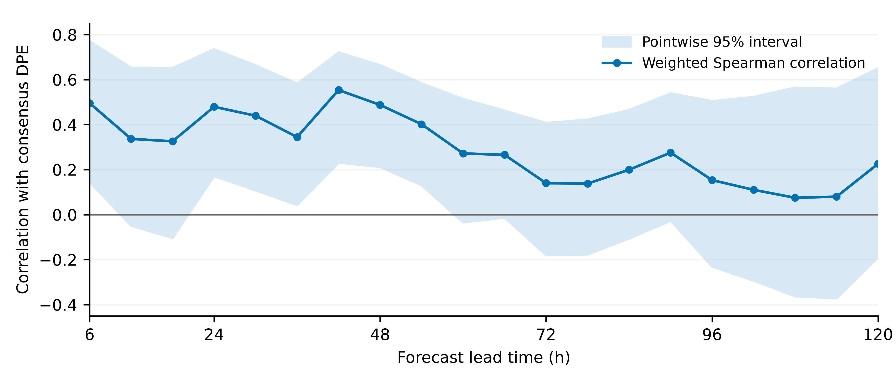

**图5-1 模型分歧与共识DPE的逐时效相关。** 曲线为台风等权的加权Spearman相关系数，阴影为台风重采样得到的逐项95%置信区间，横线为零相关。每个点比较该时效下74个案例的分歧与误差；区间分别针对各时效。程序与数据见[附录C.2](#appendix-c2)。

**短至中期可以根据模型分歧划分核查优先级。** 在6 h及24–54 h，三条AI预测路径接近时，可将该案例判断为相对低风险并按常规流程核查；三条路径明显分开时，则应提高核查优先级，重点检查中心识别、后续移动方向和环境引导气流，并与业务数值模式及最新观测进行交叉比较。模型分歧由此形成一套双向风险信号：一致对应较低的相对风险，分歧对应较高的相对风险。

**60–120 h应转向多来源综合判断。** 这一时段的相关系数为0.08–0.28，各时效区间均跨零。随着预报时间延长，三个模型可能共同偏向同一方向，也可能彼此分散但平均位置仍接近真实路径。因此，较长时效的模型一致不能直接视为低风险，模型分歧也不能单独判定为高风险，应综合业务数值模式、实时观测和天气形势判断路径可信度。

### 5.3 高分歧对大误差的识别表现

**高分歧能够把大误差案例集中到较小的核查范围内。** 留出台风检验中，以18 h为例，高分歧筛选后的大误差比例由总体的24.4%升至70.7%，提升2.90倍，同时识别出70.7%的大误差。6 h和30 h的提升倍数分别为2.58和2.29，命中率均超过一半。在这三个时效，按照第75百分位规则优先核查高分歧案例，可以覆盖超过一半的大误差事件。

**分歧阈值必须按预报时效使用。** 108 h的提升倍数为2.06，命中率为54.3%；120 h的提升倍数降至1.08，命中率为28.6%，虚警比例为68.5%。同一套“高分歧”规则在不同时效产生的筛选收益明显不同，因此风险提示应采用各时效各自的分歧阈值和历史识别表现，而不能把某一时效的有效阈值直接用于整段预报。

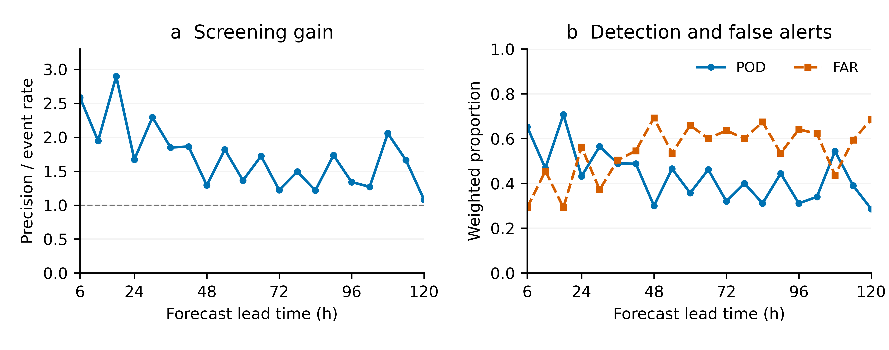

**图5-2 高分歧对大误差的逐时效筛选效果。** a，提升倍数，虚线1表示高分歧案例与总体的大误差比例相同；b，命中率POD与虚警比例FAR。各时效均采用第75百分位阈值，结果为14次留出台风检验汇总后的台风等权点估计。全时效数值及AUC等辅助指标见[附录A.4](#appendix-a4)。程序与数据见[附录C.2](#appendix-c2)。

**三模型可以组成面向核查决策的轻量级多模型系统。** 短至中期先根据分歧大小划分相对风险，再对高分歧案例调入业务数值模式、最新观测、台风环境和中心追踪结果进行重点核查；较长时效则直接采用多来源综合判断。传统热带气旋共识研究也表明，在模型离散度之外加入气旋强度等信息，能够进一步提高共识误差的预测能力。[[19]](#ref-19)

### 5.4 本章小结

1. **短至中期可以利用三模型一致程度进行双向风险分级。** 在6 h及24–54 h，三模型位置接近通常对应较小的共识路径误差，可视为相对低风险；模型位置明显分开通常对应较大的共识路径误差，应视为相对高风险。
2. **高分歧的实际价值是缩小重点核查范围。** 18 h高分歧案例中的大误差比例由总体的24.4%升至70.7%，6、18和30 h均能覆盖超过一半的大误差事件。预报中可优先核查高分歧案例，并重点对照业务数值模式、实时观测和环境引导气流。
3. **较长时效需要由分歧判断转向多来源综合判断。** 60–120 h的分歧与误差关系减弱，三模型一致也可能来自共同偏差。不同预报时效应分别设置分歧阈值和风险指标，较长时效还需把AI模型共识与独立业务预报共同纳入路径判断。
4. **三个确定性AI模型可以组成轻量级风险筛查系统。** 该系统不只输出一条平均路径，还利用模型之间的一致与分歧安排核查顺序，使多模型比较从事后误差评价延伸到预报发布前的风险识别。

<a id="chapter6"></a>

## 第六章 总结与展望

### 6.1 总结与局限性

本文建立了2025年西北太平洋台风的配对回报样本，按“总体误差—路径变化—风险提示”评价GraphCast、Pangu-Weather和FourCastNet。主分析固定14个台风、74个完整案例，使各时效基于相同样本；台风等权与台风重采样用于处理滚动起报数量不同及组内相关性。

总体比较显示，GraphCast在6–66 h的平均DPE最小，Pangu-Weather在72–120 h最小；按距离RMSE，最低误差模型的变化出现在72–78 h之间。120 h两项指标的样本顺序一致，但GraphCast与Pangu-Weather的平均DPE差异尚未达到覆盖60项比较的整体统计标准。相对FourCastNet，GraphCast在54–114 h、Pangu-Weather在54–120 h的较小平均DPE获得同时置信带支持。

路径诊断显示，三模型在120 h的样本平均绝对ATE均大于CTE，但直接检验方向差值的同时区间均包含零。五个转向台风在同台风、同预报时效的可匹配阶段中，三模型转向后的平均DPE较高，个别台风却呈相反变化，九项同时区间也均包含零。转向组整体的120 h平均DPE和绝对ATE较高，但组间差值及模型×路径类型交互缺乏联合统计支持；Pangu-Weather的误差结构和分组结果还对HALONG敏感。另13个截短台风在共同6–36 h同样呈现GraphCast样本平均DPE最低，但Pangu-Weather与FourCastNet的误差增长大于完整样本；它们既无120 h记录，也无法形成同台风同lead的转向前后配对。冻结转向时刻的参考方向后，阶段沿轨差值明显缩小，说明位置误差方向的解释取决于坐标定义。本样本不能确认普遍的速度预报机制或‘转向后模型必然更差’。

风险分析显示，6 h及24–54 h可以根据三模型的一致程度划分相对风险：位置接近通常对应较小误差，明显分歧通常对应较大误差。高分歧还能把大误差集中到优先核查的案例中，因此三个确定性AI模型可以组成轻量级风险筛查系统。短至中期按分歧安排核查顺序，较长时效则结合业务数值模式、实时观测和天气形势开展多来源综合判断。

上述结论主要受三方面条件限制。其一，样本来自一个年份，完整窗口筛选又保留了具有较长验证阶段的台风和起报时段，不能无条件推广至全部业务起报。其二，仅5个主分析台风归入转向组，少数案例会明显改变分组和误差结构结果。其三，ERA5初始化、事后最佳路径辅助裁剪和自动中心提取构成了本文的回报条件；追踪参数检验不能完全排除误追踪或区域裁剪的影响。本文也未设置业务数值模式对照，因而结论是三种所用模型配置之间的比较。

### 6.2 展望

**扩充独立年份，并将研究范围拓展到更多海盆。** 首先增加公开训练时段之后的独立年份，在统一的样本筛选和评价规则下，检验三模型的路径误差、转向前后变化及分歧识别效果。随后将研究范围由西北太平洋拓展到北大西洋、东北太平洋等海盆，增加热带气旋样本，积累更多大误差个例和转向过程。跨年份、跨海盆的比较能够进一步识别不同模型共同的误差特征，以及与区域和路径类型有关的差异。

**利用预报发布时可获得的资料识别转向阶段，发展业务风险提示。** 将实时观测、分析场与预测路径结合，判断台风所处的运动阶段及未来转向可能性，再检验模型分歧能否提前提示大误差。在此基础上，按时间顺序验证不同预报时效的风险识别表现，比较分歧指标、阈值及模型组合，使风险提示建立在实际预报时可获得的信息上。

**增加业务数值模式对照，评价人工智能模型的应用价值。** 在共同起报时刻和验证样本下，比较人工智能模型与业务数值模式的总体路径误差、转向阶段表现和大误差识别能力，并进一步检验两类模型组合后的共识预报效果，确定各模型的适用场景及互补价值。

<a id="appendix-a"></a>

## 附录A 结果的可靠性

### A.1 纳入其他13个台风

#### A.1.1 全部可用案例的逐时效结果

补充分析纳入全部27个台风、87个案例，并在各时效使用有效记录。6–36 h共有27个台风，随后随着截短案例退出，台风数逐步减少；120 h仍为主分析的14个台风、74个案例。因此，增加截短案例能够检查较短时效对样本范围的敏感程度，但没有增加120 h的独立台风信息。

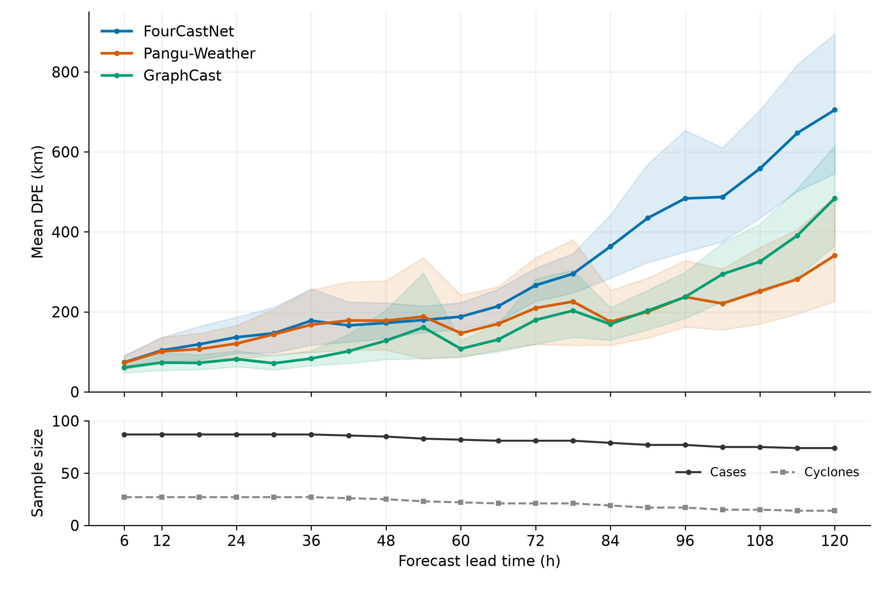

**图A-1a 全部可用案例的平均DPE及样本量。** 各时效的样本构成不同，曲线变化同时包含误差演变与样本变化，不能按固定样本曲线解释。

#### A.1.2 13个截短台风的独立分组比较

补充样本包含另外13个台风，每个台风保留一个36–108 h的起报案例。比较窗口取两批样本共同覆盖的6–36 h：完整样本先在台风内平均多个案例，截短样本使用每台风唯一案例，再分别按台风等权。另取14个完整台风各自首个完整案例，检查起报次数对排序的影响；42–78 h按时效报告有效台风数。完整时效覆盖数、程序及原始统计表见[补充分析方案：supplement_13/分析方案.md](https://github.com/Fei789844/ai-typhoon-track-evaluation-2025/blob/13a8a9487c1fe18b8cc24485fe0e4db4f94464e9/supplement_13/%E5%88%86%E6%9E%90%E6%96%B9%E6%A1%88.md)和[复现说明：supplement_13/README.md](https://github.com/Fei789844/ai-typhoon-track-evaluation-2025/blob/13a8a9487c1fe18b8cc24485fe0e4db4f94464e9/supplement_13/README.md)。

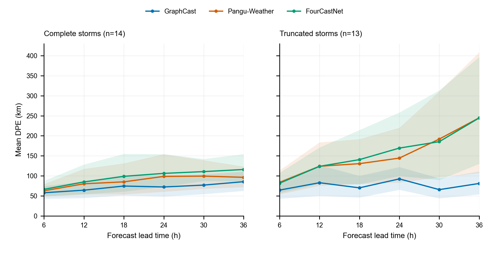

**图A-1b 两批台风在共同6–36 h的平均DPE。** 每幅图内保持台风等权，阴影为逐时效台风bootstrap 95%区间，左右两图使用相同纵轴。右图只包含13个台风各自唯一的截短起报；因此比较的是不同台风集合，不是原14台风增加起报次数。来源：[分组均值及区间：supplement_13/tables/cohort_DPE_CI_common6_36.csv](https://github.com/Fei789844/ai-typhoon-track-evaluation-2025/blob/13a8a9487c1fe18b8cc24485fe0e4db4f94464e9/supplement_13/tables/cohort_DPE_CI_common6_36.csv)。

**表A-1a 共同短时效的平均DPE及6–36 h端点净变化，单位km。** 表中“完整14个”为台风内先平均所有完整案例；“截短13个”为每台风一个案例。截短样本的端点变化是先在每个台风求36 h减6 h，再对台风等权。来源：[共同短时效均值：supplement_13/tables/cohort_means_common6_36.csv](https://github.com/Fei789844/ai-typhoon-track-evaluation-2025/blob/13a8a9487c1fe18b8cc24485fe0e4db4f94464e9/supplement_13/tables/cohort_means_common6_36.csv)、[端点变化区间：supplement_13/tables/growth6_to36.csv](https://github.com/Fei789844/ai-typhoon-track-evaluation-2025/blob/13a8a9487c1fe18b8cc24485fe0e4db4f94464e9/supplement_13/tables/growth6_to36.csv)。

| 模型 | 完整14个：36 h DPE | 截短13个：6 h DPE | 截短13个：36 h DPE | 截短13个：6→36 h变化 |
|---|---:|---:|---:|---:|
| GraphCast | 85.4 | 64.4 | 81.0 | +16.6 |
| Pangu-Weather | 96.3 | 83.5 | 244.9 | +161.4 |
| FourCastNet | 115.9 | 81.6 | 244.7 | +163.1 |

**两批样本在共同6–36 h均呈现GraphCast平均DPE最小。** 在6、12、18、24、30、36 h六个共同采样时效，GraphCast都是13个截短台风中平均DPE最小的模型；这与14个完整台风按全部案例台风等权所得的这六个时效排序一致。36 h的配对比较为：36 h的GraphCast−Pangu-Weather平均差为−163.9 km，覆盖三组模型配对×六时效的同时区间为[−369.8, 42.0] km；GraphCast−FourCastNet差为−163.7 km，同时区间为[−341.8, 14.4] km，两项同时区间均包含零。36 h逐一删除任一截短台风后，这两组平均差仍为负，样本平均方向不由单个台风决定。[配对差值：supplement_13/tables/paired_DPE_common6_36.csv](https://github.com/Fei789844/ai-typhoon-track-evaluation-2025/blob/13a8a9487c1fe18b8cc24485fe0e4db4f94464e9/supplement_13/tables/paired_DPE_common6_36.csv)、[逐一删除表：supplement_13/tables/short_pair_LOCO.csv](https://github.com/Fei789844/ai-typhoon-track-evaluation-2025/blob/13a8a9487c1fe18b8cc24485fe0e4db4f94464e9/supplement_13/tables/short_pair_LOCO.csv)给出全部结果。作为起报次数敏感性检查，只取14个完整台风各自首个案例时，36 h的Pangu-Weather均值88.2 km、GraphCast 95.6 km，样本排序会反过来；说明起报案例的选取会改变模型的平均排序。

**误差增长形态并不一致。** 截短样本在6–36 h的平均DPE端点增量为GraphCast +16.6 km、Pangu-Weather +161.4 km、FourCastNet +163.1 km；完整样本相应为+27.6、+33.6、+49.5 km。直接比较模型配对差值的端点变化，截短样本中GraphCast−FourCastNet从6 h到36 h再下降146.5 km，其三组模型配对联合区间为[−285.3, −7.7] km；GraphCast−Pangu-Weather下降144.8 km，联合区间[−310.3, 20.6] km仍包含零。前一结果提示在**这批截短台风的6–36 h窗口内**，GraphCast相对FourCastNet的平均差距扩大；该端点比较作为首轮结果后的补充诊断，GraphCast−Pangu-Weather的对应区间包含零。[增长配对检验：supplement_13/tables/pair_gap_change6_to36.csv](https://github.com/Fei789844/ai-typhoon-track-evaluation-2025/blob/13a8a9487c1fe18b8cc24485fe0e4db4f94464e9/supplement_13/tables/pair_gap_change6_to36.csv)保存三个模型配对的直接比较。

**共同短时效的误差方向因模型而异。**截短样本36 h的平均绝对ATE与绝对CTE分别为GraphCast 49.2和48.3 km、Pangu-Weather 190.4和120.0 km、FourCastNet 195.7和120.7 km。GraphCast两分量几乎相等；另外两模型的样本沿轨绝对均值较大，但覆盖三模型×六时效的18项同时区间在36 h都包含零。此处结果对应6–36 h共同窗口。[分量差值表：supplement_13/tables/short_direction_contrast.csv](https://github.com/Fei789844/ai-typhoon-track-evaluation-2025/blob/13a8a9487c1fe18b8cc24485fe0e4db4f94464e9/supplement_13/tables/short_direction_contrast.csv)保留每个时效的直接检验。

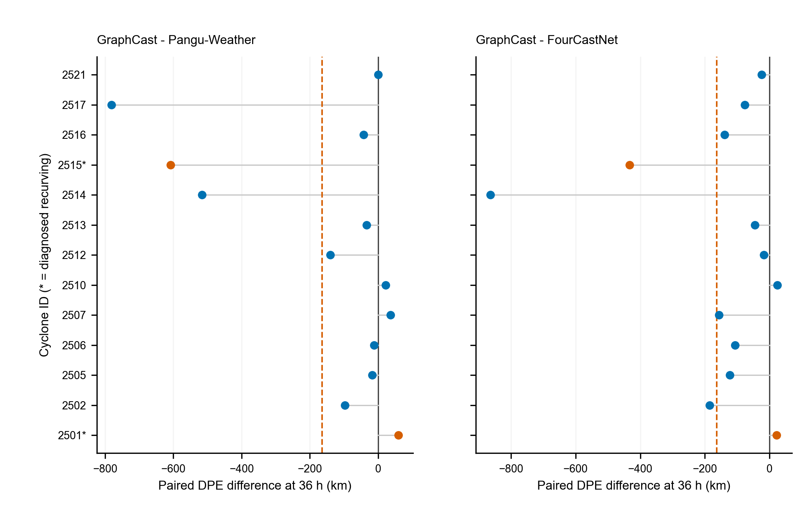

**图A-1c 截短样本逐台风的36 h模型配对DPE差值。** 负值表示GraphCast误差较小，虚线是13台风均值；星号是按整段JMA路径识别的转向台风。GraphCast相对Pangu-Weather在9个台风误差较小、3个较大、1个相同；相对FourCastNet在11个较小、2个较大。较大的个例差值会放大均值，故同时列出逐台风结果。来源：[逐台风配对差：supplement_13/tables/short_pair_by_storm.csv](https://github.com/Fei789844/ai-typhoon-track-evaluation-2025/blob/13a8a9487c1fe18b8cc24485fe0e4db4f94464e9/supplement_13/tables/short_pair_by_storm.csv)。

**截短样本的转向组均值主要受PEIPAH影响。** 13个截短台风中，WUTIP（2501）和PEIPAH（2515）被相同规则识别为转向。36 h验证时刻，WUTIP处于转向时刻，PEIPAH处于转向后36 h；两者的GraphCast/Pangu-Weather/FourCastNet DPE分别为143.8/84.2/122.4 km和175.5/783.6/608.8 km，Pangu-Weather与FourCastNet的较大组均值主要来自PEIPAH。每个台风只有一个起报案例，无法在同一预报时效形成转向前后配对，因此本项用于描述路径分组与个例差异。起报、转向时刻及逐台风数值见[阶段支持表：supplement_13/tables/short_turn_case_support.csv](https://github.com/Fei789844/ai-typhoon-track-evaluation-2025/blob/13a8a9487c1fe18b8cc24485fe0e4db4f94464e9/supplement_13/tables/short_turn_case_support.csv)和[个体误差表：supplement_13/tables/short_turn_individual_common6_36.csv](https://github.com/Fei789844/ai-typhoon-track-evaluation-2025/blob/13a8a9487c1fe18b8cc24485fe0e4db4f94464e9/supplement_13/tables/short_turn_individual_common6_36.csv)。

**时效延长后，剩余样本的组成与模型排序同时变化。** 72 h可验证的截短台风为7个，GraphCast、Pangu-Weather和FourCastNet的平均DPE依次为245.2、346.2和243.6 km，其中SEPAT和MITAG的大误差明显影响均值。该七台风子集的排序与完整样本不同，需结合有效台风名单解释。截短案例均不足120 h，120 h结果仍对应主分析的14个完整台风。[逐时效支持度：supplement_13/tables/short_support_by_lead.csv](https://github.com/Fei789844/ai-typhoon-track-evaluation-2025/blob/13a8a9487c1fe18b8cc24485fe0e4db4f94464e9/supplement_13/tables/short_support_by_lead.csv)和[42–78 h描述均值：supplement_13/tables/secondary_DPE_42_to78.csv](https://github.com/Fei789844/ai-typhoon-track-evaluation-2025/blob/13a8a9487c1fe18b8cc24485fe0e4db4f94464e9/supplement_13/tables/secondary_DPE_42_to78.csv)列出对应样本及统计量。

**补充分析显示，短时效模型排序可在两批样本中重现，误差增长及方向结构则随样本和起报设置改变。** GraphCast在两批样本的共同6–36 h均具有最小样本平均DPE；Pangu-Weather和FourCastNet在截短样本中的误差增长更大。13个单次起报案例提供短时效的样本对照，完整样本承担120 h及同台风转向前后配对分析。

### A.2 逐一删除台风与加权方式

逐一删除14个主分析台风，每次以剩余13个台风重算指标。120 h的GraphCast−Pangu-Weather平均DPE差值在14次删除中均为正，范围为119.1–161.4 km。重新计算覆盖60项比较的同时置信带后，只有5次删除结果的下界高于零。因此，Pangu-Weather样本均值较小的方向较稳定，而是否达到整体统计判据会随台风构成变化。

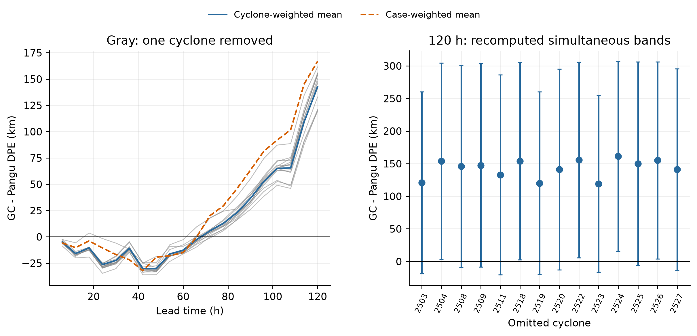

**图A-2 单台风删除与加权方式敏感性。** 左图灰线为各次删除后的平均差值曲线；右图各点为120 h删除后的平均差值，竖线为重新构建的同时区间。5/14为满足区间下界高于零的删除次数比例，不是Pangu-Weather更好的概率。

改为案例等权后，120 h的GraphCast−Pangu-Weather差值为166.8 km。该方向与台风等权一致，但数值改变，说明起报案例数不等会影响总体差距。本文仍以台风等权作为主要估计对象。

Pangu-Weather的误差结构对HALONG较敏感。删除该台风后，其120 h沿轨平方误差占比由61.8%降至31.6%，转向组减未转向组的DPE差值变为−28.4 km。HALONG的4个完整案例中，Pangu-Weather的120 h平均DPE为1086.3 km，平均ATE为−1085.6 km，平均绝对CTE为35.2 km，显示这些大偏差在当前局部方向下主要为滞后。相关场诊断用于定位高影响记录，尚不能独立判定全部偏差来自模型演变还是错误系统追踪。

**HALONG对Pangu-Weather的均方误差贡献高于其对平均DPE的贡献。** 记HALONG在120 h的四个案例误差为 $E_{Hj}$，台风内均值为 $\overline E_H$。台风等权下，该台风对总体均方误差的贡献比例为

$$
C_{\mathrm{MSE},H}=
\frac{\frac1{14}\frac14\sum_{j=1}^{4}E_{Hj}^{2}}
{\mathrm{RMSE}^{2}}
\geq\frac{\overline E_H^{\,2}}{14\,\mathrm{RMSE}^{2}}
\approx\frac{1086.3^{2}}{14\times445.2^{2}}=42.5\%.
$$

不等式来自平方的平均值不小于平均值的平方，因此42.5%是贡献比例的下限。该台风对平均DPE的贡献比例为

$$
C_{\mathrm{DPE},H}=\frac{\overline E_H/14}{\overline E}
\approx\frac{1086.3}{14\times341.0}=22.8\%.
$$

以上比例用正文展示数值近似计算。直接从逐台风统计值删除HALONG后，对剩余13个台风等权平均，Pangu-Weather、GraphCast和FourCastNet的120 h平均DPE分别为283.6、439.3和677.5 km，排序保持不变。结果经[研究三至六逐台风统计：data/storm_level.csv](https://github.com/Fei789844/ai-typhoon-track-evaluation-2025/blob/13a8a9487c1fe18b8cc24485fe0e4db4f94464e9/data/storm_level.csv)与[第四章逐台风统计：tables/group_storm_lead_means.csv](https://github.com/Fei789844/ai-typhoon-track-evaluation-2025/blob/13a8a9487c1fe18b8cc24485fe0e4db4f94464e9/tables/group_storm_lead_means.csv)交叉核对。

### A.3 方向定义、转向规则与追踪参数

方向敏感性检验比较“回看12 h”与“前后各6 h”的参考方向，并在共同有效记录上使用5、10和20 km位移阈值。转向经度阈值从0.5°提高到2°时，主分析转向台风数由6个减至2个，表明分组依赖具体识别规则。本文沿用归档分析的1°阈值作为主结果，其余阈值用于敏感性检查。

固定区域气象场，只改变一个追踪参数，120 h平均DPE见表A-1b。六种设置的样本平均排序均为Pangu-Weather、GraphCast、FourCastNet由小到大，但具体数值发生变化。因此，所测范围内的平均排序较稳定，绝对误差仍受中心提取规则影响。

**表A-1b 六种追踪设置的120 h平均DPE，单位km。**

| 设置 | GraphCast | Pangu-Weather | FourCastNet | GraphCast−Pangu |
|---|---:|---:|---:|---:|
| 基线 | 483.7 | 341.0 | 705.0 | 142.7 |
| 起始搜索半径500 km | 478.3 | 308.3 | 656.6 | 170.0 |
| 起始搜索半径900 km | 483.7 | 339.6 | 677.5 | 144.1 |
| 外推系数0 | 490.1 | 350.4 | 631.1 | 139.8 |
| 外推系数1 | 503.5 | 332.5 | 698.2 | 171.0 |
| 风速权重0 | 483.6 | 338.6 | 706.5 | 145.0 |

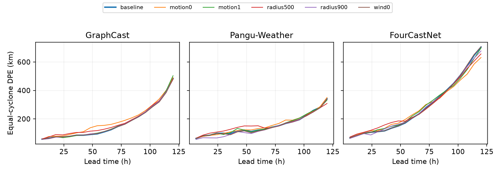

**图A-3 同一原始区域预报场在不同追踪参数下的平均DPE。** 模型气象场保持固定，改变的是连续追踪过程。

候选排序也影响连续追踪的可重复性。采用气压升序、同压时按原生网格索引升序的确定规则后，与历史未规定同压次序的实现相比，4896条验证记录中59条中心位置发生变化，最大位置差为1080.2 km。基线另有78条记录的搜索域、15条记录的250 km风速统计域可能接触裁剪边界。这些标记提示需要扩大区域检查，并非误追踪的直接判定。

<a id="appendix-a4"></a>

### A.4 模型分歧与风险识别的完整结果

本节保留第五章的20个时效统计值，并补充风险排序和预警精确率图，供逐项核对。

**表A-4 全时效相关关系与留出台风风险识别结果。** 相关系数后的方括号为逐项95%置信区间；POD和FAR以百分数表示，按台风等权计算。提升倍数为预警精确率除以总体大误差发生率，风险识别采用第75百分位阈值。来源：[相关统计表：data/IMD_correlations.csv](https://github.com/Fei789844/ai-typhoon-track-evaluation-2025/blob/13a8a9487c1fe18b8cc24485fe0e4db4f94464e9/data/IMD_correlations.csv)、[风险识别统计表：data/IMD_LOCO_metrics.csv](https://github.com/Fei789844/ai-typhoon-track-evaluation-2025/blob/13a8a9487c1fe18b8cc24485fe0e4db4f94464e9/data/IMD_LOCO_metrics.csv)。

| 时效/h | 相关系数及95%区间 | AUC | POD/% | FAR/% | 提升倍数 |
|---:|---:|---:|---:|---:|---:|
| 6 | 0.50 [0.14, 0.77] | 0.72 | 65.2 | 29.2 | 2.58 |
| 12 | 0.34 [−0.05, 0.65] | 0.70 | 46.8 | 45.5 | 1.95 |
| 18 | 0.33 [−0.10, 0.65] | 0.82 | 70.7 | 29.3 | 2.90 |
| 24 | 0.48 [0.17, 0.74] | 0.77 | 43.2 | 56.2 | 1.67 |
| 30 | 0.44 [0.11, 0.66] | 0.73 | 56.5 | 37.2 | 2.29 |
| 36 | 0.34 [0.04, 0.58] | 0.73 | 48.9 | 50.5 | 1.85 |
| 42 | 0.55 [0.23, 0.72] | 0.75 | 48.8 | 54.5 | 1.86 |
| 48 | 0.49 [0.21, 0.67] | 0.64 | 30.0 | 69.2 | 1.29 |
| 54 | 0.40 [0.13, 0.58] | 0.67 | 46.5 | 53.5 | 1.82 |
| 60 | 0.27 [−0.04, 0.52] | 0.58 | 35.7 | 65.9 | 1.36 |
| 66 | 0.27 [−0.01, 0.46] | 0.73 | 46.2 | 60.0 | 1.72 |
| 72 | 0.14 [−0.18, 0.41] | 0.63 | 32.0 | 63.6 | 1.22 |
| 78 | 0.14 [−0.18, 0.42] | 0.63 | 40.0 | 60.0 | 1.49 |
| 84 | 0.20 [−0.11, 0.47] | 0.62 | 31.1 | 67.4 | 1.22 |
| 90 | 0.28 [−0.03, 0.54] | 0.67 | 44.4 | 53.5 | 1.74 |
| 96 | 0.15 [−0.23, 0.51] | 0.57 | 31.1 | 64.1 | 1.34 |
| 102 | 0.11 [−0.29, 0.52] | 0.56 | 34.0 | 62.2 | 1.27 |
| 108 | 0.08 [−0.36, 0.57] | 0.70 | 54.3 | 43.7 | 2.06 |
| 114 | 0.08 [−0.37, 0.56] | 0.67 | 39.0 | 59.4 | 1.66 |
| 120 | 0.23 [−0.19, 0.65] | 0.66 | 28.6 | 68.5 | 1.08 |

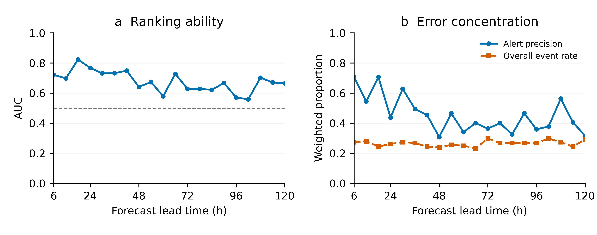

**图A-4 风险排序与大误差集中程度。** a，AUC，虚线0.5为随机排序的参考水平；b，高分歧预警的精确率与总体大误差发生率，两者之比为正文图5-2的提升倍数。曲线为各时效留出台风检验的台风等权点估计。来源：[风险识别统计表：data/IMD_LOCO_metrics.csv](https://github.com/Fei789844/ai-typhoon-track-evaluation-2025/blob/13a8a9487c1fe18b8cc24485fe0e4db4f94464e9/data/IMD_LOCO_metrics.csv)。

<a id="appendix-b"></a>

## 附录B 中心追踪细节

### B.1 锚点与搜索区域

6 h锚点为起报JMA位置。从第 $k\ge2$ 个6 h时次开始，用前两个已识别中心的经纬度位移外推0.75倍；经度位移取周期修正后的最短有符号差。搜索半径为

$$
r_k=\min\{700+20(k-1),\ 1000\}\ \mathrm{km},\qquad k=1,\ldots,20.
$$

### B.2 候选筛选和评分

搜索范围内按海平面气压升序排列有效网格点，同压时按原生扁平网格索引升序排列。检查最多2000个点；只有与所有已保留候选点均相距至少150 km的点才加入候选集，最多保留20个。中心采用原始网格位置，不额外进行网格间插值或暖心筛选。

候选点 $c$ 的气压亏缺为

$$
\delta p(c)=\max\{0,p_{\mathrm{med}}-p(c)\},
$$

其中 $p_{\mathrm{med}}$ 为当前搜索域有效海平面气压中位数。设 $d(c,a_k)$ 为到锚点的距离，$V_{250}(c)$ 为250 km内最大10 m风速，则评分为

$$
S(c)=\frac{d(c,a_k)}{r_k}
-\frac{\delta p(c)}{20\ \mathrm{hPa}}
-0.35\frac{V_{250}(c)}{40\ \mathrm{m\,s^{-1}}}.
$$

三个无量纲项分别衡量距离、相对低压程度和风速。距离项为正，气压亏缺和风速项为负，因此靠近锚点、气压较低或风速较大都会降低得分。选择 $\arg\min_c S(c)$ 作为中心。缺少有效风速时省略风速项，涡度项权重固定为零。该评分表示算法选择规则，不是候选点属于真实台风中心的概率。

<a id="appendix-c"></a>

## 附录C 统计计算与程序

本试验通过ai-models接口运行模型。Pangu-Weather加载pangu_weather_6.onnx和pangu_weather_24.onnx两个已训练模型文件；ONNX为模型保存与运行所用的格式。FourCastNet的运行参数为`--model-version 0`，对应本试验加载的fourcastnet0.0配置。

### C.1 同时置信带

以 $k$ 标记一个“模型配对—时效”坐标，$D_{ik}$ 为台风 $i$ 内平均配对差值。原样本均值与标准误为

$$
\widehat\Delta_k=\frac1N\sum_iD_{ik},\qquad
s_k^2=\frac1{N-1}\sum_i(D_{ik}-\widehat\Delta_k)^2,\qquad
\widehat{\mathrm{SE}}_k=\frac{s_k}{\sqrt N}.
$$

每次联合重采样后，计算

$$
M^{*(b)}=\max_{k=1,\ldots,60}
\left|\frac{\widehat\Delta_k^{*(b)}-\widehat\Delta_k}
{\widehat{\mathrm{SE}}_k}\right|.
$$

令其第95百分位数为 $q_{0.95}$，同时置信带为

$$
\widehat\Delta_k\pm q_{0.95}\widehat{\mathrm{SE}}_k.
$$

本次归档基线的临界值为2.9360；联合重采样100000次，随机种子20261003。标准误在重采样过程中固定为原样本值，故这是中心化bootstrap的近似同时置信带。14个台风条件下的覆盖性能仍有有限样本不确定性。

<a id="appendix-c2"></a>

### C.2 程序、数据与GitHub文件索引

论文配套程序、输入、统计表和图件保存于[GitHub项目仓库](https://github.com/Fei789844/ai-typhoon-track-evaluation-2025)。以下链接固定到归档提交 `13a8a9487c1fe18b8cc24485fe0e4db4f94464e9`，便于按论文版本核对；仓库目前为私有，查阅者需具有访问权限。文件夹均以仓库根目录为起点。

**程序索引。** 统计复现从归档的预报中心坐标开始。`code/upstream/`保存上游追踪与统计程序；从气象场重新提取中心需准备相应GRIB文件。运行步骤及依赖见[README.md](https://github.com/Fei789844/ai-typhoon-track-evaluation-2025/blob/13a8a9487c1fe18b8cc24485fe0e4db4f94464e9/README.md)与[REPRODUCIBILITY.md](https://github.com/Fei789844/ai-typhoon-track-evaluation-2025/blob/13a8a9487c1fe18b8cc24485fe0e4db4f94464e9/docs/REPRODUCIBILITY.md)。

| 对应分析或用途 | 文件夹 | 程序或说明文件（GitHub） |
|---|---|---|
| 项目复现入口 | `scripts` | [reproduce.py](https://github.com/Fei789844/ai-typhoon-track-evaluation-2025/blob/13a8a9487c1fe18b8cc24485fe0e4db4f94464e9/scripts/reproduce.py) |
| 仓库文件与样本核验 | `scripts` | [verify_repository.py](https://github.com/Fei789844/ai-typhoon-track-evaluation-2025/blob/13a8a9487c1fe18b8cc24485fe0e4db4f94464e9/scripts/verify_repository.py) |
| 复现范围与输入要求 | `docs` | [REPRODUCIBILITY.md](https://github.com/Fei789844/ai-typhoon-track-evaluation-2025/blob/13a8a9487c1fe18b8cc24485fe0e4db4f94464e9/docs/REPRODUCIBILITY.md) |
| 字段及计算口径 | `docs` | [DATA_DICTIONARY.md](https://github.com/Fei789844/ai-typhoon-track-evaluation-2025/blob/13a8a9487c1fe18b8cc24485fe0e4db4f94464e9/docs/DATA_DICTIONARY.md) |
| 样本目录构建 | `code` | [build_2025_jma_case_catalog.py](https://github.com/Fei789844/ai-typhoon-track-evaluation-2025/blob/13a8a9487c1fe18b8cc24485fe0e4db4f94464e9/code/build_2025_jma_case_catalog.py) |
| 中心追踪 | `code/upstream` | [tracker_deterministic.py](https://github.com/Fei789844/ai-typhoon-track-evaluation-2025/blob/13a8a9487c1fe18b8cc24485fe0e4db4f94464e9/code/upstream/tracker_deterministic.py) |
| 追踪参数对照 | `code/upstream` | [retrack_verified.py](https://github.com/Fei789844/ai-typhoon-track-evaluation-2025/blob/13a8a9487c1fe18b8cc24485fe0e4db4f94464e9/code/upstream/retrack_verified.py) |
| 第三章平均DPE | `code/upstream` | [experiment1.py](https://github.com/Fei789844/ai-typhoon-track-evaluation-2025/blob/13a8a9487c1fe18b8cc24485fe0e4db4f94464e9/code/upstream/experiment1.py) |
| 第三章模型配对与同时置信带 | `code/upstream` | [experiment2.py](https://github.com/Fei789844/ai-typhoon-track-evaluation-2025/blob/13a8a9487c1fe18b8cc24485fe0e4db4f94464e9/code/upstream/experiment2.py) |
| 第三章RMSE | `code` | [derive_rmse.py](https://github.com/Fei789844/ai-typhoon-track-evaluation-2025/blob/13a8a9487c1fe18b8cc24485fe0e4db4f94464e9/code/derive_rmse.py) |
| 第四章方向、转向及分组分析 | `code` | [analyze_chapter4.py](https://github.com/Fei789844/ai-typhoon-track-evaluation-2025/blob/13a8a9487c1fe18b8cc24485fe0e4db4f94464e9/code/analyze_chapter4.py) |
| 第四章逐时效及删除检验 | `code` | [extend_lead_analysis.py](https://github.com/Fei789844/ai-typhoon-track-evaluation-2025/blob/13a8a9487c1fe18b8cc24485fe0e4db4f94464e9/code/extend_lead_analysis.py) |
| 第四章绘图 | `code` | [plot_chapter4.py](https://github.com/Fei789844/ai-typhoon-track-evaluation-2025/blob/13a8a9487c1fe18b8cc24485fe0e4db4f94464e9/code/plot_chapter4.py) |
| 第四章独立核验 | `code` | [verify_chapter4.py](https://github.com/Fei789844/ai-typhoon-track-evaluation-2025/blob/13a8a9487c1fe18b8cc24485fe0e4db4f94464e9/code/verify_chapter4.py) |
| 第五章分歧相关与留出台风风险检验 | `code/upstream` | [experiments3to6.py](https://github.com/Fei789844/ai-typhoon-track-evaluation-2025/blob/13a8a9487c1fe18b8cc24485fe0e4db4f94464e9/code/upstream/experiments3to6.py) |
| 第五章绘图 | `code` | [plot_chapter5_focused.py](https://github.com/Fei789844/ai-typhoon-track-evaluation-2025/blob/13a8a9487c1fe18b8cc24485fe0e4db4f94464e9/code/plot_chapter5_focused.py) |
| 补充台风统计 | `supplement_13/code` | [analyze_short.py](https://github.com/Fei789844/ai-typhoon-track-evaluation-2025/blob/13a8a9487c1fe18b8cc24485fe0e4db4f94464e9/supplement_13/code/analyze_short.py) |
| 补充台风绘图 | `supplement_13/code` | [plot_short.py](https://github.com/Fei789844/ai-typhoon-track-evaluation-2025/blob/13a8a9487c1fe18b8cc24485fe0e4db4f94464e9/supplement_13/code/plot_short.py) |
| 补充台风独立核验 | `supplement_13/code` | [verify_short.py](https://github.com/Fei789844/ai-typhoon-track-evaluation-2025/blob/13a8a9487c1fe18b8cc24485fe0e4db4f94464e9/supplement_13/code/verify_short.py) |

**论文所引数据与配套文件。** `data/overall_by_lead.csv`用于第三章平均DPE，`tables/overall_by_lead.csv`用于第四章误差方向分解，两者按文件夹区分。下表逐项对应正文及附录中引用的文件。

| 内容 | 文件夹 | 文件（GitHub） |
|---|---|---|
| 输入哈希 | `audit` | [input_manifest.json](https://github.com/Fei789844/ai-typhoon-track-evaluation-2025/blob/13a8a9487c1fe18b8cc24485fe0e4db4f94464e9/audit/input_manifest.json) |
| 分析程序 | `code` | [analyze_chapter4.py](https://github.com/Fei789844/ai-typhoon-track-evaluation-2025/blob/13a8a9487c1fe18b8cc24485fe0e4db4f94464e9/code/analyze_chapter4.py) |
| derive_rmse.py | `code` | [derive_rmse.py](https://github.com/Fei789844/ai-typhoon-track-evaluation-2025/blob/13a8a9487c1fe18b8cc24485fe0e4db4f94464e9/code/derive_rmse.py) |
| 绘图源程序 | `code` | [draw_basis_reference.py](https://github.com/Fei789844/ai-typhoon-track-evaluation-2025/blob/13a8a9487c1fe18b8cc24485fe0e4db4f94464e9/code/draw_basis_reference.py) |
| 绘图程序 | `code` | [plot_chapter4.py](https://github.com/Fei789844/ai-typhoon-track-evaluation-2025/blob/13a8a9487c1fe18b8cc24485fe0e4db4f94464e9/code/plot_chapter4.py) |
| 独立核对程序 | `code` | [verify_chapter4.py](https://github.com/Fei789844/ai-typhoon-track-evaluation-2025/blob/13a8a9487c1fe18b8cc24485fe0e4db4f94464e9/code/verify_chapter4.py) |
| IMD_LOCO_metrics.csv | `data` | [IMD_LOCO_metrics.csv](https://github.com/Fei789844/ai-typhoon-track-evaluation-2025/blob/13a8a9487c1fe18b8cc24485fe0e4db4f94464e9/data/IMD_LOCO_metrics.csv) |
| IMD_correlations.csv | `data` | [IMD_correlations.csv](https://github.com/Fei789844/ai-typhoon-track-evaluation-2025/blob/13a8a9487c1fe18b8cc24485fe0e4db4f94464e9/data/IMD_correlations.csv) |
| overall_by_lead.csv | `data` | [overall_by_lead.csv](https://github.com/Fei789844/ai-typhoon-track-evaluation-2025/blob/13a8a9487c1fe18b8cc24485fe0e4db4f94464e9/data/overall_by_lead.csv) |
| paired_by_lead.csv | `data` | [paired_by_lead.csv](https://github.com/Fei789844/ai-typhoon-track-evaluation-2025/blob/13a8a9487c1fe18b8cc24485fe0e4db4f94464e9/data/paired_by_lead.csv) |
| 运行记录 | `data` | [rmse_audit.json](https://github.com/Fei789844/ai-typhoon-track-evaluation-2025/blob/13a8a9487c1fe18b8cc24485fe0e4db4f94464e9/data/rmse_audit.json) |
| 逐时效结果 | `data` | [rmse_by_lead.csv](https://github.com/Fei789844/ai-typhoon-track-evaluation-2025/blob/13a8a9487c1fe18b8cc24485fe0e4db4f94464e9/data/rmse_by_lead.csv) |
| 研究三至六逐台风统计 | `data` | [storm_level.csv](https://github.com/Fei789844/ai-typhoon-track-evaluation-2025/blob/13a8a9487c1fe18b8cc24485fe0e4db4f94464e9/data/storm_level.csv) |
| 程序索引与复现范围 | `docs` | [上游程序说明.md](https://github.com/Fei789844/ai-typhoon-track-evaluation-2025/blob/13a8a9487c1fe18b8cc24485fe0e4db4f94464e9/docs/%E4%B8%8A%E6%B8%B8%E7%A8%8B%E5%BA%8F%E8%AF%B4%E6%98%8E.md) |
| 固定方案 | `docs` | [第四章分析方案.md](https://github.com/Fei789844/ai-typhoon-track-evaluation-2025/blob/13a8a9487c1fe18b8cc24485fe0e4db4f94464e9/docs/%E7%AC%AC%E5%9B%9B%E7%AB%A0%E5%88%86%E6%9E%90%E6%96%B9%E6%A1%88.md) |
| JMA位置归档 | `inputs` | [jma_track_points.csv](https://github.com/Fei789844/ai-typhoon-track-evaluation-2025/blob/13a8a9487c1fe18b8cc24485fe0e4db4f94464e9/inputs/jma_track_points.csv) |
| 复现说明 | `supplement_13` | [README.md](https://github.com/Fei789844/ai-typhoon-track-evaluation-2025/blob/13a8a9487c1fe18b8cc24485fe0e4db4f94464e9/supplement_13/README.md) |
| 统计程序 | `supplement_13/code` | [analyze_short.py](https://github.com/Fei789844/ai-typhoon-track-evaluation-2025/blob/13a8a9487c1fe18b8cc24485fe0e4db4f94464e9/supplement_13/code/analyze_short.py) |
| 独立核对 | `supplement_13/code` | [verify_short.py](https://github.com/Fei789844/ai-typhoon-track-evaluation-2025/blob/13a8a9487c1fe18b8cc24485fe0e4db4f94464e9/supplement_13/code/verify_short.py) |
| 分组均值及区间 | `supplement_13/tables` | [cohort_DPE_CI_common6_36.csv](https://github.com/Fei789844/ai-typhoon-track-evaluation-2025/blob/13a8a9487c1fe18b8cc24485fe0e4db4f94464e9/supplement_13/tables/cohort_DPE_CI_common6_36.csv) |
| 共同短时效均值 | `supplement_13/tables` | [cohort_means_common6_36.csv](https://github.com/Fei789844/ai-typhoon-track-evaluation-2025/blob/13a8a9487c1fe18b8cc24485fe0e4db4f94464e9/supplement_13/tables/cohort_means_common6_36.csv) |
| 端点变化区间 | `supplement_13/tables` | [growth6_to36.csv](https://github.com/Fei789844/ai-typhoon-track-evaluation-2025/blob/13a8a9487c1fe18b8cc24485fe0e4db4f94464e9/supplement_13/tables/growth6_to36.csv) |
| 增长配对检验 | `supplement_13/tables` | [pair_gap_change6_to36.csv](https://github.com/Fei789844/ai-typhoon-track-evaluation-2025/blob/13a8a9487c1fe18b8cc24485fe0e4db4f94464e9/supplement_13/tables/pair_gap_change6_to36.csv) |
| 配对差值 | `supplement_13/tables` | [paired_DPE_common6_36.csv](https://github.com/Fei789844/ai-typhoon-track-evaluation-2025/blob/13a8a9487c1fe18b8cc24485fe0e4db4f94464e9/supplement_13/tables/paired_DPE_common6_36.csv) |
| 42–78 h描述均值 | `supplement_13/tables` | [secondary_DPE_42_to78.csv](https://github.com/Fei789844/ai-typhoon-track-evaluation-2025/blob/13a8a9487c1fe18b8cc24485fe0e4db4f94464e9/supplement_13/tables/secondary_DPE_42_to78.csv) |
| 分量差值表 | `supplement_13/tables` | [short_direction_contrast.csv](https://github.com/Fei789844/ai-typhoon-track-evaluation-2025/blob/13a8a9487c1fe18b8cc24485fe0e4db4f94464e9/supplement_13/tables/short_direction_contrast.csv) |
| 逐一删除表 | `supplement_13/tables` | [short_pair_LOCO.csv](https://github.com/Fei789844/ai-typhoon-track-evaluation-2025/blob/13a8a9487c1fe18b8cc24485fe0e4db4f94464e9/supplement_13/tables/short_pair_LOCO.csv) |
| 逐台风配对差 | `supplement_13/tables` | [short_pair_by_storm.csv](https://github.com/Fei789844/ai-typhoon-track-evaluation-2025/blob/13a8a9487c1fe18b8cc24485fe0e4db4f94464e9/supplement_13/tables/short_pair_by_storm.csv) |
| 逐时效支持度 | `supplement_13/tables` | [short_support_by_lead.csv](https://github.com/Fei789844/ai-typhoon-track-evaluation-2025/blob/13a8a9487c1fe18b8cc24485fe0e4db4f94464e9/supplement_13/tables/short_support_by_lead.csv) |
| 阶段支持表 | `supplement_13/tables` | [short_turn_case_support.csv](https://github.com/Fei789844/ai-typhoon-track-evaluation-2025/blob/13a8a9487c1fe18b8cc24485fe0e4db4f94464e9/supplement_13/tables/short_turn_case_support.csv) |
| 个体误差表 | `supplement_13/tables` | [short_turn_individual_common6_36.csv](https://github.com/Fei789844/ai-typhoon-track-evaluation-2025/blob/13a8a9487c1fe18b8cc24485fe0e4db4f94464e9/supplement_13/tables/short_turn_individual_common6_36.csv) |
| 分析方案 | `supplement_13` | [分析方案.md](https://github.com/Fei789844/ai-typhoon-track-evaluation-2025/blob/13a8a9487c1fe18b8cc24485fe0e4db4f94464e9/supplement_13/%E5%88%86%E6%9E%90%E6%96%B9%E6%A1%88.md) |
| 记录级分析表 | `tables` | [analysis_records.csv](https://github.com/Fei789844/ai-typhoon-track-evaluation-2025/blob/13a8a9487c1fe18b8cc24485fe0e4db4f94464e9/tables/analysis_records.csv) |
| 正负差值计数 | `tables` | [event_cell_sign_counts.csv](https://github.com/Fei789844/ai-typhoon-track-evaluation-2025/blob/13a8a9487c1fe18b8cc24485fe0e4db4f94464e9/tables/event_cell_sign_counts.csv) |
| 删除检验表 | `tables` | [event_loco.csv](https://github.com/Fei789844/ai-typhoon-track-evaluation-2025/blob/13a8a9487c1fe18b8cc24485fe0e4db4f94464e9/tables/event_loco.csv) |
| 逐时效差值 | `tables` | [event_matched_lead_differences.csv](https://github.com/Fei789844/ai-typhoon-track-evaluation-2025/blob/13a8a9487c1fe18b8cc24485fe0e4db4f94464e9/tables/event_matched_lead_differences.csv) |
| 阶段推断表 | `tables` | [event_primary_inference.csv](https://github.com/Fei789844/ai-typhoon-track-evaluation-2025/blob/13a8a9487c1fe18b8cc24485fe0e4db4f94464e9/tables/event_primary_inference.csv) |
| 设定敏感性表 | `tables` | [event_sensitivity.csv](https://github.com/Fei789844/ai-typhoon-track-evaluation-2025/blob/13a8a9487c1fe18b8cc24485fe0e4db4f94464e9/tables/event_sensitivity.csv) |
| 逐台风表 | `tables` | [event_storm_effects.csv](https://github.com/Fei789844/ai-typhoon-track-evaluation-2025/blob/13a8a9487c1fe18b8cc24485fe0e4db4f94464e9/tables/event_storm_effects.csv) |
| 逐时效匹配表 | `tables` | [event_support.csv](https://github.com/Fei789844/ai-typhoon-track-evaluation-2025/blob/13a8a9487c1fe18b8cc24485fe0e4db4f94464e9/tables/event_support.csv) |
| 三阶段均值 | `tables` | [event_three_phase_means.csv](https://github.com/Fei789844/ai-typhoon-track-evaluation-2025/blob/13a8a9487c1fe18b8cc24485fe0e4db4f94464e9/tables/event_three_phase_means.csv) |
| 组间差表 | `tables` | [group_difference.csv](https://github.com/Fei789844/ai-typhoon-track-evaluation-2025/blob/13a8a9487c1fe18b8cc24485fe0e4db4f94464e9/tables/group_difference.csv) |
| 交互统计表 | `tables` | [group_interactions.csv](https://github.com/Fei789844/ai-typhoon-track-evaluation-2025/blob/13a8a9487c1fe18b8cc24485fe0e4db4f94464e9/tables/group_interactions.csv) |
| 全时效逐一删除表 | `tables` | [group_loco_all_leads.csv](https://github.com/Fei789844/ai-typhoon-track-evaluation-2025/blob/13a8a9487c1fe18b8cc24485fe0e4db4f94464e9/tables/group_loco_all_leads.csv) |
| 删除范围表 | `tables` | [group_loco_envelope.csv](https://github.com/Fei789844/ai-typhoon-track-evaluation-2025/blob/13a8a9487c1fe18b8cc24485fe0e4db4f94464e9/tables/group_loco_envelope.csv) |
| 分组均值表 | `tables` | [group_means.csv](https://github.com/Fei789844/ai-typhoon-track-evaluation-2025/blob/13a8a9487c1fe18b8cc24485fe0e4db4f94464e9/tables/group_means.csv) |
| 第四章逐台风统计 | `tables` | [group_storm_lead_means.csv](https://github.com/Fei789844/ai-typhoon-track-evaluation-2025/blob/13a8a9487c1fe18b8cc24485fe0e4db4f94464e9/tables/group_storm_lead_means.csv) |
| 时段汇总表 | `tables` | [group_time_band_summary.csv](https://github.com/Fei789844/ai-typhoon-track-evaluation-2025/blob/13a8a9487c1fe18b8cc24485fe0e4db4f94464e9/tables/group_time_band_summary.csv) |
| 逐时效统计表 | `tables` | [overall_by_lead.csv](https://github.com/Fei789844/ai-typhoon-track-evaluation-2025/blob/13a8a9487c1fe18b8cc24485fe0e4db4f94464e9/tables/overall_by_lead.csv) |
| 案例目录 | `tables` | [storm_catalog.csv](https://github.com/Fei789844/ai-typhoon-track-evaluation-2025/blob/13a8a9487c1fe18b8cc24485fe0e4db4f94464e9/tables/storm_catalog.csv) |
| 候选时刻表 | `tables` | [turn_candidates.csv](https://github.com/Fei789844/ai-typhoon-track-evaluation-2025/blob/13a8a9487c1fe18b8cc24485fe0e4db4f94464e9/tables/turn_candidates.csv) |
| 逐台风判定表 | `tables` | [turn_classification.csv](https://github.com/Fei789844/ai-typhoon-track-evaluation-2025/blob/13a8a9487c1fe18b8cc24485fe0e4db4f94464e9/tables/turn_classification.csv) |

输入校验值及运行记录见[input_manifest.json](https://github.com/Fei789844/ai-typhoon-track-evaluation-2025/blob/13a8a9487c1fe18b8cc24485fe0e4db4f94464e9/audit/input_manifest.json)、[analysis_audit.json](https://github.com/Fei789844/ai-typhoon-track-evaluation-2025/blob/13a8a9487c1fe18b8cc24485fe0e4db4f94464e9/audit/analysis_audit.json)和[verification.json](https://github.com/Fei789844/ai-typhoon-track-evaluation-2025/blob/13a8a9487c1fe18b8cc24485fe0e4db4f94464e9/audit/verification.json)。

本次新增RMSE的核心计算为：

```python
# x: 同一模型、同一时效的完整案例；一个台风可以有多个案例。
storm_mse = (
    x.assign(squared=x.track_error_km**2)
     .groupby("TC_ID").squared.mean()
     .sort_index().to_numpy()
)
rmse = np.sqrt(storm_mse.mean())
rng = np.random.default_rng(20261018)
indices = rng.integers(0, 14, size=(10000, 14))
bootstrap_rmse = np.sqrt(storm_mse[indices].mean(axis=1))
ci95 = np.quantile(bootstrap_rmse, [0.025, 0.975])
```

完整程序对全部模型和时效共用一组台风抽样索引，并检查模型间案例配对及平均DPE与归档值一致。正文RMSE表采用逐时效区间，未增加RMSE配对的多重比较检验。

本次整理未重新运行全球天气模型，也未重新生成原始区域气象场。原有追踪与统计流程的复现范围以项目记录为准；从气象场开始重做中心提取还需对应GRIB输入。文件与图表来源、校验值及本次修改说明单独保存在配套核对材料中。

<a id="references"></a>

## 参考文献

<a id="ref-1"></a>

[1] NOAA National Hurricane Center. Hurricane Hazards and Risks[EB/OL]. [引用日期：2026-10-18]. [官方页面](https://www.nhc.noaa.gov/prepare/hazards.php).

<a id="ref-2"></a>

[2] Heming J T. Tropical cyclone tracking and verification techniques for Met Office numerical weather prediction models[J]. Meteorological Applications, 2017, 24(1): 1–8. [DOI: 10.1002/met.1599](https://doi.org/10.1002/met.1599).

<a id="ref-3"></a>

[3] Lam R, Sanchez-Gonzalez A, Willson M, et al. Learning skillful medium-range global weather forecasting[J]. Science, 2023, 382(6677): 1416–1421. [DOI: 10.1126/science.adi2336](https://doi.org/10.1126/science.adi2336). [作者公开稿](https://arxiv.org/abs/2212.12794). [官方模型与训练时段说明](https://github.com/google-deepmind/weathernext/blob/main/docs/weathernext1_graph/README.md).

<a id="ref-4"></a>

[4] Bi K, Xie L, Zhang H, et al. Accurate medium-range global weather forecasting with 3D neural networks[J]. Nature, 2023, 619: 533–538. [DOI: 10.1038/s41586-023-06185-3](https://doi.org/10.1038/s41586-023-06185-3). [作者公开稿](https://arxiv.org/abs/2211.02556).

<a id="ref-5"></a>

[5] DeMaria M, Franklin J L, Chirokova G, et al. An Operations-Based Evaluation of Tropical Cyclone Track and Intensity Forecasts from Artificial Intelligence Weather Prediction Models[J]. Artificial Intelligence for the Earth Systems, 2025. [DOI: 10.1175/AIES-D-24-0085.1](https://doi.org/10.1175/AIES-D-24-0085.1). [作者预印本](https://arxiv.org/abs/2409.06735).

<a id="ref-6"></a>

[6] Japan Meteorological Agency, RSMC Tokyo–Typhoon Center. RSMC Best Track Data[DB/OL]. [引用日期：2026-10-18]. [官方资料入口](https://www.jma.go.jp/jma/jma-eng/jma-center/rsmc-hp-pub-eg/besttrack.html).

<a id="ref-7"></a>

[7] Pathak J, Subramanian S, Harrington P, et al. FourCastNet: A Global Data-driven High-resolution Weather Model using Adaptive Fourier Neural Operators[EB/OL]. arXiv预印本, 2022. [DOI: 10.48550/arXiv.2202.11214](https://doi.org/10.48550/arXiv.2202.11214).

<a id="ref-8"></a>

[8] Chen L, Zhong X, Zhang F, et al. FuXi: a cascade machine learning forecasting system for 15-day global weather forecast[J]. npj Climate and Atmospheric Science, 2023, 6: 190. [DOI: 10.1038/s41612-023-00512-1](https://doi.org/10.1038/s41612-023-00512-1).

<a id="ref-9"></a>

[9] Alet F, Andersson T R, Price I, et al. Operational tropical cyclone forecasting with AI[J/OL]. Nature, 2026. [DOI: 10.1038/s41586-026-10953-2](https://doi.org/10.1038/s41586-026-10953-2).

<a id="ref-10"></a>

[10] Elsberry R L, Carr L E III. Consensus of Dynamical Tropical Cyclone Track Forecasts—Errors versus Spread[J]. Monthly Weather Review, 2000, 128(12): 4131–4138. [DOI: 10.1175/1520-0493(2000)129<4131:CODTCT>2.0.CO;2](https://doi.org/10.1175/1520-0493%282000%29129%3C4131%3ACODTCT%3E2.0.CO%3B2).

<a id="ref-11"></a>

[11] Cameron A C, Miller D L. A Practitioner’s Guide to Cluster-Robust Inference[J]. Journal of Human Resources, 2015, 50(2): 317–372. [DOI: 10.3368/jhr.50.2.317](https://doi.org/10.3368/jhr.50.2.317). [作者公开全文](https://cameron.econ.ucdavis.edu/research/Cameron_Miller_JHR_2015.pdf).

<a id="ref-12"></a>

[12] Hersbach H, Bell B, Berrisford P, et al. The ERA5 global reanalysis[J]. Quarterly Journal of the Royal Meteorological Society, 2020, 146: 1999–2049. [DOI: 10.1002/qj.3803](https://doi.org/10.1002/qj.3803).

<a id="ref-13"></a>

[13] Chernozhukov V, Chetverikov D, Kato K, Koike Y. High-Dimensional Data Bootstrap[J]. Annual Review of Statistics and Its Application, 2023, 10: 427–449. [DOI: 10.1146/annurev-statistics-040120-022239](https://doi.org/10.1146/annurev-statistics-040120-022239).

<a id="ref-14"></a>

[14] Japan Meteorological Agency. 2025年（令和7年）の台風について（確定）[R/OL]. 2026-03-27 [引用日期：2026-10-20]. [官方报告及路径图](https://www.jma.go.jp/jma/press/2603/27a/2025kakutei.pdf).

<a id="ref-15"></a>

[15] Rasp S, Dueben P D, Scher S, et al. WeatherBench: A Benchmark Data Set for Data-Driven Weather Forecasting[J]. Journal of Advances in Modeling Earth Systems, 2020, 12(11): e2020MS002203. [DOI: 10.1029/2020MS002203](https://doi.org/10.1029/2020MS002203).

<a id="ref-16"></a>

[16] Rasp S, Hoyer S, Merose A, et al. WeatherBench 2: A Benchmark for the Next Generation of Data-Driven Global Weather Models[J]. Journal of Advances in Modeling Earth Systems, 2024, 16(6): e2023MS004019. [DOI: 10.1029/2023MS004019](https://doi.org/10.1029/2023MS004019).

<a id="ref-17"></a>

[17] Price I, Sanchez-Gonzalez A, Alet F, et al. Probabilistic weather forecasting with machine learning[J]. Nature, 2025, 637: 84–90. [DOI: 10.1038/s41586-024-08252-9](https://doi.org/10.1038/s41586-024-08252-9).

<a id="ref-18"></a>

[18] Goerss J S. Tropical Cyclone Track Forecasts Using an Ensemble of Dynamical Models[J]. Monthly Weather Review, 2000, 128(4): 1187–1193. [DOI: 10.1175/1520-0493(2000)128<1187:TCTFUA>2.0.CO;2](https://doi.org/10.1175/1520-0493%282000%29128%3C1187%3ATCTFUA%3E2.0.CO%3B2).

<a id="ref-19"></a>

[19] Goerss J S. Prediction of Consensus Tropical Cyclone Track Forecast Error[J]. Monthly Weather Review, 2007, 135(5): 1985–1993. [DOI: 10.1175/MWR3390.1](https://doi.org/10.1175/MWR3390.1).

<a id="ref-20"></a>

[20] Leonardo N M, Colle B A. Verification of Multimodel Ensemble Forecasts of North Atlantic Tropical Cyclones[J]. Weather and Forecasting, 2017, 32(6): 2083–2101. [DOI: 10.1175/WAF-D-17-0058.1](https://doi.org/10.1175/WAF-D-17-0058.1).

<a id="acknowledgements"></a>

## 致谢

感谢导师在选题确定、研究框架、统计分析和论文修改过程中给予的指导，使本文能够围绕台风路径预报这一问题逐步形成完整的研究思路。感谢课题组老师和同学在模型运行、数据整理、结果讨论和论文表达方面提供的帮助。

感谢欧洲中期天气预报中心提供ERA5再分析资料，感谢日本气象厅提供西北太平洋热带气旋最佳路径资料，感谢GraphCast、Pangu-Weather和FourCastNet研究团队公开论文、模型及相关技术资料，为本文开展可复核的模型比较提供了基础。

感谢家人在学习和论文写作期间给予的理解与支持。谨向所有关心和帮助过本研究的人表示诚挚感谢。
